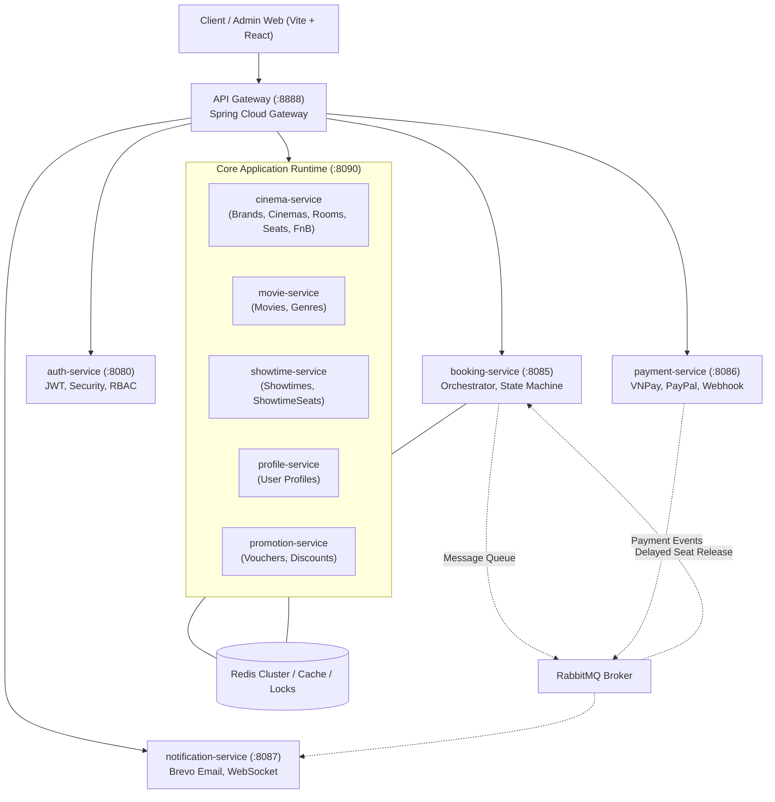

# TÀI LIỆU PHÂN TÍCH BÀI TOÁN NGHIỆP VỤ VÀ ROADMAP KỸ THUẬT HỆ THỐNG ĐẶT VÉ XEM PHIM (CINEMEOW)

---

## MỤC LỤC
1. [TỔNG QUAN KIẾN TRÚC HỆ THỐNG CINEMEOW](#phần-i-tổng-quan-kiến-trúc-hệ-thống-cinemeow)
2. [PHÂN TÍCH 17 BÀI TOÁN NGHIỆP VỤ CỐT LÕI](#phần-ii-phân-tích-17-bài-toán-nghiệp-vụ-cốt-lõi)
   - [Phân hệ 1: Seat & Map Seat (Ghế và Sơ đồ ghế)](#1-phân-hệ-seat--map-seat-ghế-và-sơ-đồ-ghế)
   - [Phân hệ 2: Showtime & Room (Suất chiếu và Phòng chiếu)](#2-phân-hệ-showtime--room-suất-chiếu-và-phòng-chiếu)
   - [Phân hệ 3: Promotion & Pricing (Khuyến mãi và Định giá)](#3-phân-hệ-promotion--pricing-khuyến-mãi-và-định-giá)
   - [Phân hệ 4: Payment, F&B & Transaction Lifecycle](#4-phân-hệ-payment-fb--transaction-lifecycle)
   - [Phân hệ 5: Auth & API Gateway (Bảo mật và Cửa ngõ)](#5-phân-hệ-auth--api-gateway-bảo-mật-và-cửa-ngõ)
   - [Phân hệ 6: Notification, Resilience & Check-in](#6-phân-hệ-notification-resilience--check-in)
3. [BẢNG TỔNG HỢP MỨC ĐỘ ƯU TIÊN VÀ CÔNG NGHỆ ÁP DỤNG](#phần-iii-bảng-tổng-hợp-mức-độ-ưu-tiên-và-công-nghệ-áp-dụng)
4. [ROADMAP THỰC HÀNH KỸ THUẬT THEO 5 CẤP ĐỘ (LEVEL 1 -> LEVEL 5)](#phần-iv-roadmap-thực-hành-kỹ-thuật-theo-5-cấp-độ)
   - [Level 1: Thuật toán nghiệp vụ & Ràng buộc Database thuần](#level-1-thuật-toán-nghiệp-vụ--ràng-buộc-database-thuần)
   - [Level 2: Concurrency & Caching trong nội bộ Service](#level-2-concurrency--caching-trong-nội-bộ-service)
   - [Level 3: Giao tiếp liên Service, Bảo vệ tài nguyên & Fault Tolerance](#level-3-giao-tiếp-liên-service-bảo-vệ-tài-nguyên--fault-tolerance)
   - [Level 4: Xử lý bất đồng bộ, Message Queue & Real-time](#level-4-xử-lý-bất-đồng-bộ-message-queue--real-time)
   - [Level 5: Giao dịch phân tán, Bảo mật cao cấp & Đối soát tài chính](#level-5-giao-dịch-phân-tán-bảo-mật-cao-cấp--đối-soát-tài-chính)
5. [KẾ HOẠCH BẮT ĐẦU NGAY VỚI DỰ ÁN CINEMEOW](#phần-v-kế-hoạch-bắt-đầu-ngay-với-dự-án-cinemeow)

---

# PHẦN I. TỔNG QUAN KIẾN TRÚC HỆ THỐNG CINEMEOW

Hệ thống CineMeow được xây dựng theo mô hình **Hybrid Architecture (Modular Monolith kết hợp Microservices)**:



* **Module `core-app` (:8090):** Đóng gói các domain quản lý danh mục (Catalog/Master Data) gồm `movie`, `cinema`, `showtime`, `profile`, `promotion` vào chung một tiến trình JVM để tối ưu hiệu năng gọi in-memory (Nano-seconds).
* **Các Microservice độc lập:** `auth-service` (:8080), `booking-service` (:8085), `payment-service` (:8086), `notification-service` (:8087) và `api-gateway` (:8888).

---

# PHẦN II. PHÂN TÍCH 17 BÀI TOÁN NGHIỆP VỤ CỐT LÕI

## 1. Phân hệ Seat & Map Seat (Ghế và Sơ đồ ghế)

### 1.1. Bài toán 1: Tranh chấp giữ ghế đồng thời (Seat-Holding Race Condition)
* **Kịch bản:** Suất chiếu bom tấn mở bán. 50 khách hàng cùng lúc bấm chọn ghế VIP `E10` trong cùng một mili-giây.
* **Vấn đề:** Nếu dùng `SELECT` kiểm tra rồi mới `UPDATE`, nhiều luồng cùng thấy ghế trống và cùng chuyển sang bước thanh toán, gây ra lỗi đặt trùng ghế (Double Booking).
* **Giải pháp:**
  * Dùng **Redis Lua Script** để thực hiện kiểm tra và khóa đồng thời danh sách ghế nguyên tử (Atomic Lock).
  * Đặt TTL giữ ghế mặc định 10 phút.
  * Ghế chuyển sang trạng thái `HELD`. Nếu sau 10 phút chưa thanh toán thành công, ghế tự động được giải phóng.
* **Công nghệ:** Redis, Redis Lua Script, Distributed Lock.

### 1.2. Bài toán 2: Quy tắc chống bỏ trống một ghế đơn độc (Single-Seat Gap Rule)
* **Kịch bản:** Một hàng ghế có 10 chỗ `[1, 2, 3, 4, 5, 6, 7, 8, 9, 10]`. Ghế 1, 2, 3 đã bán. Khách tiếp theo chọn mua ghế 5, 6.
* **Vấn đề:** Ghế số 4 bị bỏ lại cô độc giữa ghế đã bán (số 3) và ghế đang mua (số 5). Ghế đơn lẻ này cực kỳ khó bán cho khách đi theo cặp, gây thất thu cho rạp.
* **Giải pháp:**
  * Xây dựng thuật toán quét mảng (Array Scanning / Sliding Window) trên sơ đồ ghế của hàng đó.
  * Kiểm tra các kịch bản để lại khoảng trống `gap = 1`:
    * Khoảng trống giữa 2 ghế đã đặt/đang giữ.
    * Khoảng trống sát vách tường trái/phải.
    * Khoảng trống sát lối đi.
  * Nếu phát hiện `gap = 1`, từ chối thao tác và hiển thị cảnh báo cho khách.
* **Công nghệ:** Business Algorithm, Array Scanning, Matrix Traversal.

### 1.3. Bài toán 3: Ràng buộc ghế đôi (Sweetbox / Couple Seat)
* **Kịch bản:** Người dùng chọn mua ghế Sweetbox (ví dụ `A1-A2`).
* **Vấn đề:** Nếu cho phép mua riêng `A1` hoặc `A2`, kết cấu ghế đôi bị phá vỡ và ghế còn lại không thể bán được.
* **Giải pháp:**
  * Định nghĩa cấu trúc `SeatGroup` (nhóm ghế phụ thuộc).
  * Bắt buộc validate ở tầng Service: Khi chọn 1 ghế trong cụm ghế đôi, hệ thống tự động chọn cả ghế còn lại.
  * Mở khóa / hủy cũng phải giải phóng đồng thời cả cụm.
* **Công nghệ:** Group Constraint Validation, Atomic State Update.

### 1.4. Bài toán 4: Đồng bộ sơ đồ ghế thời gian thực (Real-time Seat Map Sync)
* **Kịch bản:** Khách hàng A vừa bấm giữ ghế `E10`. Có 20 khách hàng khác cũng đang mở màn hình chọn ghế của cùng suất chiếu đó.
* **Vấn đề:** 20 khách còn lại không hề biết `E10` đã bị giữ, vẫn nhấn vào chọn và liên tục nhận thông báo lỗi "Ghế đã có người giữ", gây trải nghiệm tồi tệ.
* **Giải pháp:**
  * Tích hợp **Spring WebSocket (STOMP)** kết hợp **Redis Pub/Sub**.
  * Ngay khi `E10` đổi trạng thái (`AVAILABLE -> HELD -> BOOKED -> AVAILABLE`), `showtime-service` bắn sự kiện qua Redis Pub/Sub.
  * WebSocket Server broadcast message đến channel `/topic/showtime/{showtimeId}`.
  * Màn hình của 20 khách lập tức tự động đổi màu ghế `E10` sang màu đỏ/vàng theo thời gian thực mà không cần F5.
* **Công nghệ:** Spring WebSocket, STOMP Protocol, Redis Pub/Sub.

---

## 2. Phân hệ Showtime & Room (Suất chiếu và Phòng chiếu)

### 2.1. Bài toán 5: Chống trùng lịch phòng chiếu (Schedule Collision & Cleaning Buffer)
* **Kịch bản:** Admin A tạo lịch Phim A tại Phòng 1 từ 19:00 - 21:00. Admin B tạo lịch Phim B tại Phòng 1 từ 20:45 - 22:45.
* **Vấn đề:** Hai suất chiếu bị đè giờ lên nhau. Rạp cũng không đủ thời gian 15-20 phút dọn dẹp vệ sinh phòng chiếu.
* **Giải pháp:**
  * Thuật toán kiểm tra giao thoa khoảng thời gian có tính thêm thời gian đệm (Cleaning Buffer Time):
    $$\text{StartTime}_B < \text{EndTime}_A + \text{BufferTime} \quad \text{và} \quad \text{EndTime}_B + \text{BufferTime} > \text{StartTime}_A$$
  * Tầng Database: Sử dụng PostgreSQL Range Type `tstzrange` kết hợp **Exclusion Constraint** (`EXCLUDE USING gist`) để ngăn chặn hoàn toàn ở mức database engine.
* **Công nghệ:** PostgreSQL `tstzrange`, Exclusion Constraint, Interval Overlap Algorithm.

### 2.2. Bài toán 6: Sửa hoặc hủy suất chiếu khi đã có khách đặt vé
* **Kịch bản:** Phòng chiếu bị hỏng máy chiếu đột xuất, Admin bắt buộc phải hủy suất chiếu lúc 20:00 đã có 35 khách thanh toán thành công.
* **Vấn đề:** Không thể chạy lệnh `DELETE` hay `UPDATE` thông thường vì dính dữ liệu tài chính, vé và quyền lợi khách hàng.
* **Giải pháp:**
  * Đổi trạng thái suất chiếu thành `SUSPENDED` / `CANCELLED`.
  * Khóa cổng đặt vé mới cho suất chiếu này.
  * Kích hoạt quy trình bồi hoàn tự động (Batch Refund Process): Gọi API hoàn tiền VNPay, giải phóng ghế, gửi email/SMS xin lỗi kèm tặng Voucher đền bù.
* **Công nghệ:** State Machine, Refund API, Message Queue, Saga Pattern.

### 2.3. Bài toán 7: Chống sập DB khi hết hạn Cache suất chiếu bom tấn (Cache Stampede)
* **Kịch bản:** Thông tin suất chiếu phim bom tấn được lưu trong Redis Cache. Đúng 09:00 sáng mở bán, cache hết hạn (TTL = 0). Cùng lúc đó có 5.000 lượt truy vấn ùa vào.
* **Vấn đề:** 5.000 luồng đồng thời thấy cache trống và cùng gửi câu lệnh SQL phức tạp xuống Database để tính toán lại sơ đồ ghế $\rightarrow$ Database bị nghẽn CPU và sập hệ thống (Cache Stampede / Dog-piling).
* **Giải pháp:**
  * Sử dụng **Distributed Mutex Lock** (Redis Lock): Chỉ luồng đầu tiên lấy được lock mới được truy vấn Database và cập nhật lại Cache.
  * Các luồng còn lại chờ 50-100ms rồi đọc lại từ Cache đã được nạp mới.
  * Áp dụng kỹ thuật **Logical Expiration**: Cache luôn chứa timestamp hạn dùng ngầm, worker nền tự động refresh cache trước khi nó thực sự hết hạn.
* **Công nghệ:** Redis Mutex Lock, Redisson, Double-Checked Locking.

---

## 3. Phân hệ Promotion & Pricing (Khuyến mãi và Định giá)

### 3.1. Bài toán 8: Tranh chấp Voucher giới hạn số lượng (Voucher Race Condition)
* **Kịch bản:** Rạp tung mã `GIAM50K` giới hạn đúng 100 lượt sử dụng. Có 2.000 khách hàng cùng nhập mã và bấm xác nhận thanh toán.
* **Vấn đề:** Nhiều luồng cùng đọc thấy `usage_count = 99` và cùng thực hiện trừ số lượng, dẫn đến phát hành vượt quá 100 voucher (Over-redemption).
* **Giải pháp:**
  * Quản lý số lượng voucher khả dụng bằng **Redis Atomic Counter** (`DECRBY`).
  * Thực thi qua Redis Lua Script: Kiểm tra nếu `counter >= 1` thì trừ 1 và cấp quyền sử dụng; nếu `< 1` thì từ chối ngay.
  * Cơ chế bù trừ: Nếu khách hủy đơn hoặc thanh toán thất bại, gọi lệnh `INCRBY` để hoàn trả lượt sử dụng.
* **Công nghệ:** Redis Atomic Counter, Lua Script, Compensating Mechanism.

### 3.2. Bài toán 9: Biểu giá động đa chiều (Complex Dynamic Pricing Matrix)
* **Kịch bản:** Giá vé xem phim thay đổi linh hoạt theo:
  * Loại ghế: *Normal (+0đ), VIP (+15.000đ), Sweetbox (+40.000đ)*.
  * Định dạng phòng: *2D Standard, 3D, IMAX, 4DX*.
  * Khung giờ & Ngày: *Trước 12h sáng, khung giờ vàng (18h-21h), cuối tuần, ngày lễ*.
  * Đối tượng: *Học sinh/sinh viên (-20%), Thành viên VIP*.
* **Vấn đề:** Nếu viết code bằng hàng chục câu lệnh `if-else` lồng nhau, mã nguồn sẽ biến thành "spaghetti code", cực kỳ dễ sinh lỗi và không thể bảo trì.
* **Giải pháp:**
  * Áp dụng **Strategy Pattern** và **Chain of Responsibility** (hoặc Rules Engine).
  * Tách việc định giá thành các bước độc lập: `BasePriceStrategy` $\rightarrow$ `SeatTypeModifier` $\rightarrow$ `TimeSlotModifier` $\rightarrow$ `UserMembershipDiscount`.
* **Công nghệ:** Strategy Pattern, Chain of Responsibility, Spring Bean Registry.

---

## 4. Phân hệ Payment, F&B & Transaction Lifecycle

### 4.1. Bài toán 10: Xử lý lệch pha giữa thanh toán và giữ chỗ (Zombie Payment & Auto Refund)
* **Kịch bản:** Khách giữ ghế trong 10 phút. Tại phút thứ 9:55, khách bấm thanh toán VNPay. Do mạng chậm, Webhook báo thành công từ cổng thanh toán về đến hệ thống lúc 10:05 (đã quá 10 phút, ghế đã bị hệ thống nhả ra và người khác đã mua mất).
* **Vấn đề:** Khách hàng đã bị trừ tiền trong tài khoản ngân hàng, nhưng hệ thống không còn ghế để xuất vé.
* **Giải pháp:**
  * **Idempotency Webhook:** Xử lý webhook an toàn với `transactionId`.
  * **Kiểm tra trạng thái ghế khi nhận Webhook:**
    * Nếu đơn hàng vẫn hợp lệ: Chuyển sang `PAID`, xuất vé.
    * Nếu ghế đã bị mất/hết hạn: Ghi nhận đơn hàng vào bảng `payment_exceptions`, lập tức kích hoạt API **Auto Refund** (Hoàn tiền tự động qua VNPay Refund API) và gửi email/SMS xin lỗi khách hàng.
* **Công nghệ:** Payment Webhook Idempotency, VNPay Refund API, Reconciliation.

### 4.2. Bài toán 11: Mua Bắp Nước đi kèm vé (Bundle Atomicity)
* **Kịch bản:** Một đơn hàng gồm: 2 Vé xem phim + 1 Bắp Rang Bơ Phô Mai + 2 Nước ngọt.
* **Vấn đề:** Đặt ghế thành công nhưng kho bắp nước của rạp bị hết hàng hoặc module F&B gặp lỗi.
* **Giải pháp:**
  * Đảm bảo nguyên tắc "All-or-Nothing": Cả vé và bắp nước đều phải được giữ thành công thì đơn hàng mới hợp lệ.
  * Trừ tạm tồn kho F&B song song với thời gian giữ ghế.
  * Nếu một trong hai thất bại, kích hoạt cơ chế hoàn tác giải phóng phần còn lại ngay lập tức.
* **Công nghệ:** Inventory Reservation, Distributed Transaction, Compensating Action.

### 4.3. Bài toán 12: Job đối soát tài chính cuối ngày (Payment Reconciliation Job)
* **Kịch bản:** Do đứt cáp hoặc sự cố mạng, một số request Webhook từ cổng thanh toán không bao giờ đến được server CineMeow.
* **Vấn đề:** Tiền đã vào tài khoản rạp nhưng trạng thái trên hệ thống vẫn là `PENDING`, dẫn đến sai lệch sổ sách kế toán.
* **Giải pháp:**
  * Viết một Scheduled Batch Job chạy lúc 23:59 hàng ngày.
  * Tự động quét các đơn hàng ở trạng thái `PENDING` quá 15 phút.
  * Chủ động gọi API truy vấn giao dịch (`QueryDR` của VNPay) để lấy trạng thái thực tế từ cổng thanh toán:
    * Nếu cổng báo thành công: Cập nhật đơn hàng thành công hoặc tạo lệnh hoàn tiền nếu vé đã bị hủy.
    * Nếu cổng báo thất bại/chưa thanh toán: Đóng đơn hàng vĩnh viễn (`FAILED`).
* **Công nghệ:** Spring Batch / `@Scheduled`, VNPay QueryDR API.

---

## 5. Phân hệ Auth & API Gateway (Bảo mật và Cửa ngõ)

### 5.1. Bài toán 13: Thu hồi Token tức thời khi Logout (JWT Token Revocation / Blacklist)
* **Kịch bản:** Người dùng bấm Logout hoặc đổi mật khẩu trên ứng dụng, nhưng Access Token cũ vẫn còn hạn sử dụng 1 tiếng.
* **Vấn đề:** Bản chất JWT là stateless, Server không thể chủ động vô hiệu hóa token cũ nếu kẻ xấu đã kịp copy token đó.
* **Giải pháp:**
  * Khi User Logout, lấy `jti` (JWT ID) hoặc hash của token lưu vào **Redis Blacklist** với thời gian sống (TTL) bằng đúng thời gian hết hạn còn lại của token.
  * Tại `api-gateway` (hoặc JwtAuthenticationFilter), kiểm tra xem token có nằm trong Redis Blacklist không. Nếu có, lập tức trả về `401 Unauthorized`.
* **Công nghệ:** Redis Blacklist, Spring Security Filter, JWT `jti` Claim.

### 5.2. Bài toán 14: Chống cào vé & spam request tại API Gateway (Rate Limiting)
* **Kịch bản:** Bot hoặc hacker dùng tool F5 liên tục hàng ngàn lần/giây vào endpoint giữ ghế `/seats/lock` để làm tê liệt hệ thống.
* **Vấn đề:** Tài nguyên CPU, Connection Pool của các service phía sau bị cạn kiệt, khách hàng thật không thể truy cập.
* **Giải pháp:**
  * Áp dụng thuật toán **Token Bucket** hoặc **Redis Sliding Window** tại `api-gateway`.
  * Cấu hình hạn mức theo IP hoặc User ID: Ví dụ tối đa 10 request/giây cho người dùng bình thường, vượt quá ngưỡng trả về mã `429 Too Many Requests`.
* **Công nghệ:** Spring Cloud Gateway `RequestRateLimiter`, Redis Token Bucket.

---

## 6. Phân hệ Notification, Resilience & Check-in

### 6.1. Bài toán 15: Vé điện tử Offline & Dynamic QR Code chống gian lận Check-in
* **Kịch bản:** Khách mua vé thành công, chụp ảnh màn hình mã QR gửi cho 3 người bạn khác để cùng vào rạp xem phim.
* **Vấn đề:** Mã QR tĩnh có thể bị sao chép và gian lận vé vào cửa.
* **Giải pháp:**
  * Sử dụng thuật toán **Dynamic QR Code** dựa trên **TOTP (Time-based One-Time Password)** kết hợp chữ ký **HMAC-SHA256**.
  * Mã QR trên app của khách tự động thay đổi sau mỗi 30-60 giây.
  * Máy quét vé của nhân viên rạp:
    * Xác thực chữ ký HMAC và mã TOTP.
    * Chuyển trạng thái vé thành `CHECKED_IN` bằng thao tác nguyên tử (Atomic Update) để ngăn chặn việc quét đồng thời tại nhiều cửa soát vé.
* **Công nghệ:** TOTP, HMAC-SHA256, Dynamic QR Code, Atomic Check-in.

### 6.2. Bài toán 16: Fan-out thông báo suất chiếu sớm (Push Notification Storm)
* **Kịch bản:** Phim bom tấn bất ngờ mở suất chiếu sớm đặc biệt. Hệ thống cần gửi thông báo đẩy (Push Notification) và Email đến 100.000 khách hàng đã đăng ký theo dõi phim.
* **Vấn đề:** Nếu dùng vòng lặp `for` gửi đồng bộ, hệ thống sẽ nghẽn thread pool, hết bộ nhớ và gây treo server.
* **Giải pháp:**
  * Đẩy tác vụ vào Message Queue (**RabbitMQ**).
  * Chia 100.000 người dùng thành các batch nhỏ (mỗi batch 500 - 1.000 messages).
  * Triển khai Worker Pool xử lý bất đồng bộ, có cơ chế Retry Backoff và Dead-Letter Queue (DLQ) cho các email gửi lỗi.
* **Công nghệ:** RabbitMQ Worker Pool, Batch Processing, Dead-Letter Queue.

### 6.3. Bài toán 17: Ngắt mạch tự động khi Dịch vụ bên ngoài chập chờn (Circuit Breaker)
* **Kịch bản:** Cổng gửi mail Brevo hoặc Cổng thanh toán bên thứ ba gặp sự cố đường truyền, phản hồi cực kỳ chậm (timeout 30 giây).
* **Vấn đề:** Các request gọi ra ngoài giữ chặt các thread của hệ thống, làm cạn kiệt Tomcat thread pool, dẫn đến toàn bộ hệ thống CineMeow bị sập dây chuyền (Cascading Failure).
* **Giải pháp:**
  * Áp dụng **Circuit Breaker** (Resilience4j).
  * Khi tỷ lệ lỗi hoặc timeout vượt quá ngưỡng quy định (ví dụ 50% trong 10 giây), Circuit Breaker tự động chuyển sang trạng thái **OPEN** (ngắt mạch).
  * Tất cả request tiếp theo sẽ được trả ngay kết quả Fallback dự phòng mà không cần chờ đợi, bảo vệ an toàn cho hệ thống.
* **Công nghệ:** Resilience4j (CircuitBreaker, TimeLimiter, Fallback).

---

# PHẦN III. BẢNG TỔNG HỢP MỨC ĐỘ ƯU TIÊN VÀ CÔNG NGHỆ ÁP DỤNG

| Mã | Tên bài toán | Phân hệ phụ trách | Ưu tiên | Công nghệ / Pattern cốt lõi |
| :---: | :--- | :--- | :---: | :--- |
| **BT-01** | Tranh chấp giữ ghế đồng thời | `showtime-service` | **P0** | Redis Lua Script, Atomic Lock, TTL |
| **BT-02** | Quy tắc chống bỏ trống 1 ghế | `showtime-service` | **P1** | Array Scanning, Sliding Window |
| **BT-03** | Ràng buộc ghế đôi Sweetbox | `cinema-service` | **P1** | Seat Group Validation, Atomic Operation |
| **BT-04** | Đồng bộ sơ đồ ghế Real-time | `showtime-service` | **P2** | Spring WebSocket (STOMP), Redis Pub/Sub |
| **BT-05** | Chống trùng lịch phòng chiếu | `showtime-service` | **P0** | PostgreSQL Range Types, Exclusion Constraint |
| **BT-06** | Sửa/Hủy suất chiếu đã có vé | `showtime-service` | **P2** | State Machine, Refund API, Saga |
| **BT-07** | Chống sập DB khi hết hạn Cache | `movie-service` | **P1** | Redis Mutex Lock, Double-Checked Locking |
| **BT-08** | Tranh chấp Voucher số lượng có hạn | `promotion-service`| **P1** | Redis Atomic Counter, Lua Script |
| **BT-09** | Biểu giá động đa chiều | `booking-service` | **P1** | Strategy Pattern, Chain of Responsibility |
| **BT-10** | Lệch pha thanh toán & Giữ chỗ | `payment-service` | **P0** | Webhook Idempotency, Auto Refund |
| **BT-11** | Mua Bắp Nước đi kèm vé | `booking-service` | **P1** | Inventory Reservation, All-or-Nothing |
| **BT-12** | Đối soát tài chính cuối ngày | `payment-service` | **P2** | Spring Batch, VNPay QueryDR API |
| **BT-13** | Thu hồi Token khi Logout | `auth-service` | **P1** | Redis Blacklist, Spring Security Filter |
| **BT-14** | Rate Limiting tại Gateway | `api-gateway` | **P1** | Spring Cloud Gateway, Redis Token Bucket |
| **BT-15** | Dynamic QR Code Offline | `booking-service` | **P2** | TOTP, HMAC-SHA256, Atomic Check-in |
| **BT-16** | Fan-out thông báo suất sớm | `notification-service` | **P2** | RabbitMQ, Worker Pool, Dead-Letter Queue |
| **BT-17** | Circuit Breaker & Fallback | `payment-service` | **P1** | Resilience4j CircuitBreaker, Fallback |

---

# PHẦN IV. ROADMAP THỰC HÀNH KỸ THUẬT THEO 5 CẤP ĐỘ

```text
[Level 1: Thuật toán & DB thuần] 
       └──> [Level 2: Concurrency & Redis nội bộ] 
              └──> [Level 3: REST, Gateway & Resilience] 
                     └──> [Level 4: Message Queue & Real-time] 
                            └──> [Level 5: Giao dịch phân tán & Enterprise]
```

---

### LEVEL 1: THUẬT TOÁN NGHIỆP VỤ & RÀNG BUỘC DATABASE THUẦN
> **Mục tiêu:** Rèn luyện tư duy thiết kế giải thuật và khai thác triệt để các tính năng nâng cao của Relational Database (PostgreSQL). Chưa cần hạ tầng mạng phức tạp.

#### Bài 1.1: Thuật toán chống bỏ trống 1 ghế đơn độc (Single-Seat Gap Rule)
* **Độ khó:** 1.5 / 5
* **Phân hệ:** `core/showtime-service`
* **Nhiệm vụ thực hành:**
  1. Viết một class `SeatGapValidator` nhận vào ma trận ghế của hàng và danh sách ghế khách đang chọn.
  2. Xây dựng logic quét mảng: Phát hiện nếu việc chọn ghế tạo ra khoảng trống có độ dài đúng bằng 1 (`gap == 1`) so với:
     * Hai đầu mép tường (cột đầu tiên / cột cuối cùng của hàng).
     * Hai mép lối đi (ghế loại `EMPTY`).
     * Ghế đã ở trạng thái `BOOKED` hoặc `HELD`.
  3. Viết Unit Test phủ 100% các trường hợp: Chọn 1 ghế ở góc, chọn 2 ghế ở giữa, chọn để lại 1 ghế trống...

#### Bài 1.2: Ràng buộc nguyên tử cho Ghế Đôi (Sweetbox)
* **Độ khó:** 1.5 / 5
* **Phân hệ:** `core/cinema-service` & `core/showtime-service`
* **Nhiệm vụ thực hành:**
  1. Thêm trường `pairSeatId` hoặc `groupId` trong entity `Seat` và `ShowtimeSeat`.
  2. Viết logic xác thực: Nếu ghế được chọn là `SeatType.COUPLE`, bắt buộc phải nạp cả ghế cặp đôi của nó vào danh sách chọn.
  3. Khi hủy chọn hoặc hết hạn, luôn giải phóng cả cặp ghế cùng lúc.

#### Bài 1.3: Chống trùng lịch phòng chiếu bằng PostgreSQL Range Types
* **Độ khó:** 2.0 / 5
* **Phân hệ:** `core/showtime-service`
* **Nhiệm vụ thực hành:**
  1. Viết migration SQL kích hoạt extension `btree_gist` trong PostgreSQL.
  2. Thêm ràng buộc `EXCLUDE USING gist (room_id WITH =, tstzrange(start_time, end_time + interval '15 minutes') WITH &&)`.
  3. Viết method xử lý bắt ngoại lệ `DataIntegrityViolationException` tại GlobalExceptionHandler và trả về lỗi thân thiện: *"Phòng chiếu đã có lịch trùng hoặc chưa đủ 15 phút dọn dẹp"*.

#### Bài 1.4: Biểu giá động đa chiều bằng Strategy Pattern
* **Độ khó:** 2.0 / 5
* **Phân hệ:** `booking-service`
* **Nhiệm vụ thực hành:**
  1. Tạo interface `PricingStrategy` với phương thức `BigDecimal calculate(PricingContext context)`.
  2. Implement các strategy: `SeatTypePricingStrategy`, `RoomTypePricingStrategy`, `DayTimePricingStrategy`, `VipMemberPricingStrategy`.
  3. Tạo `PricingEngine` inject danh sách các Strategy và cộng dồn phụ thu để cho ra giá vé cuối cùng một cách linh hoạt, không dùng câu lệnh `if-else` lồng nhau.

---

### LEVEL 2: CONCURRENCY & CACHING TRONG NỘI BỘ SERVICE
> **Mục tiêu:** Chinh phục các bài toán môi trường đa luồng (Multi-threading), nhiều người dùng tranh chấp tài nguyên đồng thời bằng Redis và Atomic Operations.

#### Bài 2.1: Thu hồi Token tức thời khi Logout (JWT Blacklist)
* **Độ khó:** 2.0 / 5
* **Phân hệ:** `auth-service`
* **Nhiệm vụ thực hành:**
  1. Thêm claim `jti` (UUID ngẫu nhiên) vào Payload khi sinh JWT Token.
  2. Tại API `POST /auth/logout`: Lấy `jti`, tính thời gian hết hạn còn lại:
     $$\text{RemainingTTL} = \text{TokenExpirationTime} - \text{CurrentTime}$$
  3. Lưu key `blacklist:{jti}` vào Redis với TTL bằng đúng `RemainingTTL`.
  4. Trong `JwtAuthenticationFilter`, kiểm tra `redisTemplate.hasKey("blacklist:" + jti)`. Nếu tồn tại, từ chối request ngay lập tức.

#### Bài 2.2: Caching danh mục phim & Xóa Cache tự động
* **Độ khó:** 2.5 / 5
* **Phân hệ:** `core/movie-service` & `core/showtime-service`
* **Nhiệm vụ thực hành:**
  1. Cấu hình Spring Cache với Redis làm backend cache manager.
  2. Gắn `@Cacheable(value = "movies", key = "#id")` vào phương thức xem chi tiết phim.
  3. Khi Admin cập nhật thông tin phim: Dùng `@CacheEvict(value = "movies", key = "#id")` kết hợp bắn event nội bộ để xóa cả cache danh sách lịch chiếu liên quan.

#### Bài 2.3: Tranh chấp Voucher giới hạn số lượng bằng Redis Atomic Counter
* **Độ khó:** 2.5 / 5
* **Phân hệ:** `core/promotion-service`
* **Nhiệm vụ thực hành:**
  1. Khi tạo voucher có số lượng `100`, nạp vào Redis key `voucher:limit:GIAM50K = 100`.
  2. Viết Lua Script thực hiện trừ số lượng:
     ```lua
     local stock = tonumber(redis.call('get', KEYS[1]))
     if stock and stock > 0 then
         redis.call('decr', KEYS[1])
         return 1
     else
         return 0
     end
     ```
  3. Nếu kết quả trả về `1`: Cấp quyền dùng voucher. Nếu `0`: Trả về lỗi hết voucher ngay trong vòng 2 mili-giây mà không cần query Database.

#### Bài 2.4: Giữ ghế 10 phút chống chọn trùng bằng Redis Lua Script
* **Độ khó:** 3.0 / 5
* **Phân hệ:** `core/showtime-service`
* **Nhiệm vụ thực hành:**
  1. Thiết kế key Redis: `showtime:{showtimeId}:seat:{seatId}` mang giá trị `{userId}` kèm TTL 600 giây (10 phút).
  2. Viết Redis Lua Script để kiểm tra và khóa đồng thời một danh sách ghế `[E10, E11]`:
     * Kiểm tra toàn bộ danh sách ghế xem có ghế nào đã tồn tại key chưa.
     * Nếu TẤT CẢ đều trống: Thực hiện `SETEX` cho toàn bộ danh sách ghế với TTL 10 phút và trả về thành công.
     * Nếu có BẤT KỲ ghế nào đã bị giữ: Không khóa ghế nào cả (All-or-Nothing) và trả về danh sách ghế bị trùng.
  3. Viết kịch bản kiểm thử đa luồng (Multi-thread Test với JMeter hoặc `CompletableFuture`) mô phỏng 50 user tranh chấp cùng 1 ghế.

---

### LEVEL 3: GIAO TIẾP LIÊN SERVICE, BẢO VỆ TÀI NGUYÊN & FAULT TOLERANCE
> **Mục tiêu:** Xử lý khi các service độc lập gọi nhau qua HTTP/REST, bảo vệ Connection Pool, chống tấn công DDoS và ngăn chặn lỗi mạng dây chuyền.

#### Bài 3.1: Chống cào vé & spam request tại API Gateway bằng Rate Limiter
* **Độ khó:** 3.0 / 5
* **Phân hệ:** `api-gateway`
* **Nhiệm vụ thực hành:**
  1. Cấu hình Spring Cloud Gateway sử dụng `RequestRateLimiter` kết hợp Redis.
  2. Định nghĩa `KeyResolver` theo Client IP Address hoặc User ID từ JWT Header.
  3. Áp dụng giới hạn:
     * Endpoint `/api/v1/showtime/seats/lock`: Tối đa 5 request / giây, burst capacity 10.
     * Endpoint công khai khác: Tối đa 30 request / giây.
  4. Trả về mã lỗi `429 Too Many Requests` kèm Header `Retry-After` khi người dùng vượt quá hạn mức.

#### Bài 3.2: Bảo vệ Database Connection Pool bằng TransactionTemplate
* **Độ khó:** 3.0 / 5
* **Phân hệ:** `booking-service`
* **Nhiệm vụ thực hành:**
  1. Nhận thức vấn đề: Nếu gắn `@Transactional` trên toàn bộ phương thức `createBooking()`, Database Connection sẽ bị chiếm giữ trong suốt thời gian gọi REST sang `payment-service` và `showtime-service`.
  2. Tái cấu trúc lại bằng `TransactionTemplate`:
     * **Phase 1 (DB Local):** Mở transaction, lưu đơn hàng `PENDING`, commit và giải phóng connection ngay.
     * **Phase 2 (Mạng):** Gọi REST API ra ngoài (không ôm DB connection).
     * **Phase 3 (DB Local):** Mở transaction mới để cập nhật trạng thái đơn hàng.

#### Bài 3.3: End-to-End Idempotency cho API tạo đơn và thanh toán
* **Độ khó:** 3.5 / 5
* **Phân hệ:** `booking-service` & `payment-service`
* **Nhiệm vụ thực hành:**
  1. Bắt buộc Client gửi kèm Header `Idempotency-Key` (UUID) mỗi khi bấm nút thanh toán.
  2. Sử dụng Redis `SET key value NX EX 120`:
     * Nếu key chưa tồn tại: Cho phép request đi tiếp, lưu trạng thái `IN_PROGRESS`.
     * Nếu key đã tồn tại và trạng thái là `IN_PROGRESS`: Trả về `409 Conflict` (Giao dịch đang được xử lý, vui lòng không bấm liên tục).
     * Nếu key đã có kết quả (`COMPLETED`): Trả về ngay kết quả đã lưu trước đó mà không tạo đơn hàng mới.

#### Bài 3.4: Circuit Breaker & Fallback cho Cổng thanh toán và Dịch vụ gửi Mail
* **Độ khó:** 3.5 / 5
* **Phân hệ:** `payment-service` & `notification-service`
* **Nhiệm vụ thực hành:**
  1. Tích hợp thư viện `resilience4j-spring-boot3`.
  2. Bọc lời gọi sang Cổng thanh toán VNPay và API Brevo bằng `@CircuitBreaker(name = "vnpayClient", fallbackMethod = "vnpayFallback")`.
  3. Cấu hình Sliding Window 10 calls, nếu 50% cuộc gọi bị timeout > 5 giây thì chuyển sang trạng thái `OPEN`.
  4. Viết hàm Fallback trả thông báo thân thiện cho khách: *"Hệ thống thanh toán đang bảo trì, vui lòng thử lại sau ít phút"* thay vì làm sập ứng dụng.

---

### LEVEL 4: XỬ LÝ BẤT ĐỒNG BỘ, MESSAGE QUEUE & REAL-TIME
> **Mục tiêu:** Làm chủ kiến trúc Event-Driven với RabbitMQ, đảm bảo không bao giờ mất dữ liệu và nâng cao trải nghiệm thời gian thực cho người dùng.

#### Bài 4.1: Đảm bảo không mất dữ liệu bằng Transactional Outbox Pattern
* **Độ khó:** 4.0 / 5
* **Phân hệ:** `booking-service` $\rightarrow$ `RabbitMQ` $\rightarrow$ `notification-service`
* **Nhiệm vụ thực hành:**
  1. Nhận thức vấn đề: Nếu lưu Order vào DB thành công nhưng lúc gửi sang RabbitMQ thì mạng đứt $\rightarrow$ Khách mất vé, không có email xác nhận.
  2. Tạo bảng `outbox_events` trong Database của `booking-service`.
  3. Trong cùng 1 Database Transaction: Lưu `Order` đồng thời ghi 1 dòng sự kiện `OrderCreatedEvent` vào bảng `outbox_events`.
  4. Viết một Scheduled Worker (hoặc Debezium CDC) định kỳ 1 giây quét các event chưa gửi trong bảng outbox, bắn lên RabbitMQ và đánh dấu `SENT`.

#### Bài 4.2: Tự động nhả ghế & Voucher sau 10 phút bằng RabbitMQ Delayed Exchange
* **Độ khó:** 4.0 / 5
* **Phân hệ:** `booking-service`
* **Nhiệm vụ thực hành:**
  1. Cài đặt plugin `rabbitmq_delayed_message_exchange` (hoặc dùng Dead-Letter Exchange TTL).
  2. Ngay khi khách tạo đơn giữ chỗ: Bắn một message vào Delay Queue với độ trễ (delay) đúng 600.000 mili-giây (10 phút).
  3. Sau 10 phút, message rơi vào Consumer:
     * Kiểm tra trạng thái đơn hàng trong DB: Nếu trạng thái vẫn là `PENDING` (khách chưa thanh toán xong).
     * Tự động cập nhật đơn hàng thành `CANCELLED`.
     * Bắn event yêu cầu `showtime-service` giải phóng ghế và `promotion-service` hoàn lại voucher.

#### Bài 4.3: Đồng bộ sơ đồ ghế Real-time bằng Spring WebSocket (STOMP) & Redis Pub/Sub
* **Độ khó:** 4.0 / 5
* **Phân hệ:** `core/showtime-service`
* **Nhiệm vụ thực hành:**
  1. Cấu hình WebSocket message broker với endpoint `/ws-cinema` và topic prefix `/topic`.
  2. Khi có sự kiện thay đổi trạng thái ghế (`HELD`, `AVAILABLE`, `BOOKED`), service xuất bản event lên Redis Channel `showtime:seat-events`.
  3. WebSocket listener nhận event từ Redis và bắn đến topic `/topic/showtime/{showtimeId}`.
  4. Kết nối từ client (React frontend) để cập nhật tức thì màu sắc của ghế trên màn hình khách hàng mà không cần reload trang.

#### Bài 4.4: Fan-out thông báo suất chiếu sớm với Worker Pool & Dead-Letter Queue
* **Độ khó:** 4.0 / 5
* **Phân hệ:** `notification-service`
* **Nhiệm vụ thực hành:**
  1. Tạo Producer chia nhỏ 10.000 người dùng nhận tin thành các batch 500 messages, đẩy vào RabbitMQ queue `notification.broadcast.queue`.
  2. Cấu hình `SimpleMessageListenerContainer` với `concurrency = 5-10` workers chạy song song.
  3. Cấu hình Retry Policy với Exponential Backoff (1s, 2s, 4s, 8s).
  4. Nếu sau 3 lần retry vẫn lỗi (ví dụ email sai định dạng), tự động đẩy message vào `Dead-Letter Queue (DLQ)` để admin kiểm tra thủ công.

---

### LEVEL 5: GIAO DỊCH PHÂN TÁN, BẢO MẬT CAO CẤP & ĐỐI SOÁT TÀI CHÍNH
> **Mục tiêu:** Cấp độ kiến trúc sư phần mềm (Senior / Solution Architect). Đảm bảo tính nhất quán dữ liệu xuyên suốt các Microservices phân tán và xử lý các kịch bản lỗi biên phức tạp nhất.

#### Bài 5.1: Xử lý lệch pha thanh toán (Zombie Payment & Auto Refund)
* **Độ khó:** 4.5 / 5
* **Phân hệ:** `payment-service` & `booking-service`
* **Nhiệm vụ thực hành:**
  1. Giả lập tình huống mạng trễ: Webhook thanh toán thành công của VNPay đến sau phút thứ 10 (lúc này ghế đã bị Job nhả ghế giải phóng và người khác mua mất).
  2. Khi Webhook đến, `booking-service` kiểm tra thấy ghế đã bị người khác mua:
     * Ghi nhận giao dịch vào bảng `payment_exceptions` với mã lỗi `SEAT_ALREADY_SOLD_AFTER_EXPIRATION`.
     * Tự động gọi API Hoàn tiền của VNPay (`vnp_Command = refund`).
     * Gửi email xin lỗi đến khách hàng giải thích lý do ghế đã hết thời gian giữ và số tiền đã được hoàn trả về tài khoản.

#### Bài 5.2: Vé điện tử Offline & Dynamic QR Code chống gian lận Check-in
* **Độ khó:** 4.5 / 5
* **Phân hệ:** `booking-service`
* **Nhiệm vụ thực hành:**
  1. Thiết kế cơ chế sinh mã QR động dựa trên thuật toán TOTP (Time-based One-Time Password):
     $$\text{Token} = \text{HMAC-SHA256}(\text{SecretKey}, \text{BookingId} + \text{Floor}(\text{CurrentTimestamp} / 30))$$
  2. Mã QR trên ứng dụng di động tự động làm mới mỗi 30 giây một lần (chống việc chụp ảnh màn hình chuyển cho người khác).
  3. Ứng dụng quét vé của nhân viên tại rạp xác thực mã QR cục bộ bằng Secret Key mà không cần kết nối Internet.
  4. Sau khi quét thành công, cập nhật trạng thái vé thành `CHECKED_IN` bằng thao tác nguyên tử để chống quét 2 cửa cùng lúc.

#### Bài 5.3: Saga Pattern (Orchestrator) cho luồng Đặt Vé + Bắp Nước + Voucher
* **Độ khó:** 5.0 / 5
* **Phân hệ:** `booking-service`
* **Nhiệm vụ thực hành:**
  1. Xây dựng một **Saga State Machine** trong `booking-service` quản lý toàn bộ vòng đời đơn hàng.
  2. Thiết kế luồng đi xuôi (Forward Transactions):
     * Bước 1: Giữ ghế tại `showtime-service`.
     * Bước 2: Giữ bắp nước tại `cinema-service`.
     * Bước 3: Giữ voucher tại `promotion-service`.
     * Bước 4: Khởi tạo thanh toán tại `payment-service`.
  3. Thiết kế luồng đi ngược bù trừ (Compensating Transactions) khi Bước 4 hoặc bất kỳ bước nào gặp lỗi:
     * Nhả voucher $\rightarrow$ Nhả bắp nước $\rightarrow$ Nhả ghế $\rightarrow$ Đánh dấu đơn hàng `FAILED`.
  4. Đảm bảo toàn bộ hệ thống phục hồi lại trạng thái nhất quán ban đầu dù gặp sự cố ở bất kỳ bước nào.

#### Bài 5.4: Job đối soát tài chính tự động cuối ngày (Reconciliation Batch Job)
* **Độ khó:** 5.0 / 5
* **Phân hệ:** `payment-service`
* **Nhiệm vụ thực hành:**
  1. Xây dựng Spring Batch Job chạy định kỳ vào 23:59 mỗi đêm.
  2. Quét toàn bộ các đơn hàng trong ngày có trạng thái `PENDING` hoặc có nghi vấn sai lệch tiền.
  3. Gửi request sang API Đối soát giao dịch của VNPay (`vnp_Command = querydr`) để so khớp trạng thái thực tế giữa hai bên.
  4. Tự động xử lý các giao dịch mồ côi (Orphaned Transactions), xuất file báo cáo đối soát dạng Excel/CSV cho bộ phận kế toán của rạp.

---

# PHẦN V. KẾ HOẠCH BẮT ĐẦU NGAY VỚI DỰ ÁN CINEMEOW

Để không bị ngợp và đạt hiệu quả cao nhất, bạn hãy áp dụng quy tắc **"Làm từ trong ra ngoài"** dựa trên hiện trạng mã nguồn của CineMeow:

```text
TUẦN 1: Tối ưu nội bộ Core Module (Thuật toán & Ràng buộc)
├── Thực hành Bài 1.1: Single-Seat Gap Rule trong showtime-service.
├── Thực hành Bài 1.2: Ràng buộc nguyên tử cho Ghế Đôi (Sweetbox).
└── Thực hành Bài 1.3: Chống trùng lịch chiếu bằng PostgreSQL Exclusion Constraint.

TUẦN 2: Chinh phục Concurrency với Redis
├── Thực hành Bài 2.4: Viết Redis Lua Script giữ ghế 10 phút.
├── Thực hành Bài 2.3: Atomic Counter trừ số lượng Voucher.
└── Thực hành Bài 2.1: JWT Token Blacklist khi Logout tại auth-service.

TUẦN 3: Bảo vệ API Gateway & Giao tiếp REST an toàn
├── Thực hành Bài 3.1: Cấu hình Rate Limiting chống spam tại api-gateway.
├── Thực hành Bài 3.2: Tách biệt TransactionTemplate tại booking-service.
└── Thực hành Bài 3.3: Idempotency-Key chống click đúp thanh toán.

TUẦN 4: Nâng cấp kiến trúc Event-Driven với RabbitMQ
├── Thực hành Bài 4.1: Transactional Outbox Pattern cho sự kiện đặt vé.
├── Thực hành Bài 4.2: Delayed Message Queue tự động hủy vé sau 10 phút.
└── Thực hành Bài 4.3: WebSocket STOMP đồng bộ sơ đồ ghế thời gian thực.

TUẦN 5: Hoàn thiện tính năng Enterprise & Phục hồi lỗi
├── Thực hành Bài 5.1: Xử lý Zombie Payment & Auto Refund.
└── Thực hành Bài 5.3: Saga Orchestrator cho luồng Đặt vé + Bắp nước + Voucher.
```

---
*Tài liệu được biên soạn và chuẩn hóa dành riêng cho kiến trúc dự án CineMeow.*

