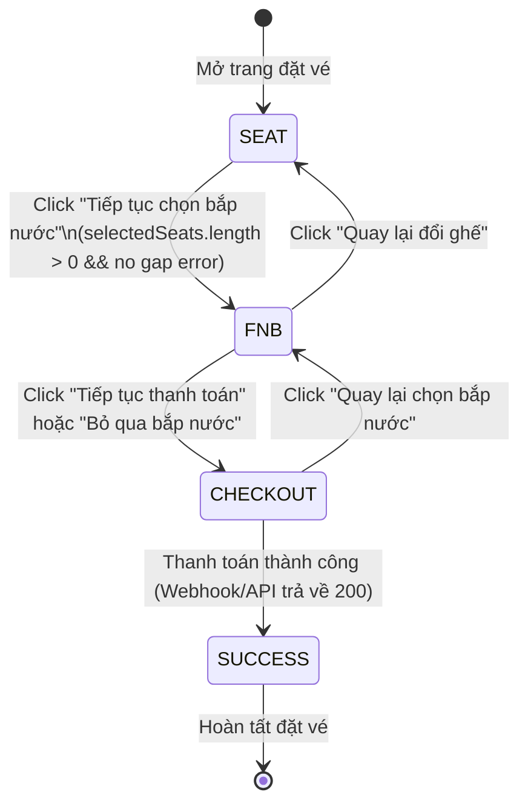

# Feature: Explicit Multi-Step Booking Flow Refactoring (Tách Biệt Chọn Vé, Bắp Nước & Thanh Toán)

| Metadata | Details |
| :--- | :--- |
| **Feature ID** | CM-000009 |
| **Category** | Frontend UX / Conversion Optimization / Booking Flow Architecture |
| **Target Services** | `frontend/client-frontend` |
| **Status** | 🟢 Live |
| **Priority** | P1 - High |
| **Author / Tech Lead** | Frontend Core Team |

---

## 1. Overview

### 1.1 Purpose
Tái cấu trúc toàn diện hành trình người dùng (User Journey) tại trang đặt vé xem phim [`BookingPage.jsx`](file:///e:/Workspace/LEARN/springboot_projects/CineMeow/frontend/client-frontend/src/pages/BookingPage.jsx) từ mô hình 2 bước kết hợp ngầm thành **mô hình Wizard 3 bước tường minh (Explicit 3-Step Wizard Flow)**:
1. **Bước 1 (Chọn Vé & Ghế Ngồi - Seat & Ticket Step):** Người dùng tập trung 100% vào việc lựa chọn vị trí ghế tối ưu trên sơ đồ phòng chiếu, thỏa mãn các ràng buộc nghiệp vụ (Single-Seat Gap Rule, Sweetbox Couple Seat Atomic Rule).
2. **Bước 2 (Chọn Bắp Nước - Food & Beverage Step):** Tách thành một trạm dừng độc lập (Full-page Upselling Milestone) ngay trên layout chính thay vì ẩn trong Modal Popup chật chội, thúc đẩy tối đa doanh số bán kèm F&B.
3. **Bước 3 (Nhập Thông Tin Nhận Vé, Voucher & Xác Nhận Thanh Toán - Checkout & Confirmation Step):** Tối ưu hóa phễu thanh toán: điền thông tin liên hệ (Email, SĐT), áp dụng mã giảm giá khuyến mãi (Voucher), chọn phương thức thanh toán và kiểm tra toàn bộ vé điện tử trước khi hoàn tất giao dịch.

```
┌─────────────────┐       ┌─────────────────┐       ┌───────────────────────────────┐
│ BƯỚC 1: CHỌN VÉ │  ──>  │ BƯỚC 2: BẮP NƯỚC│  ──>  │ BƯỚC 3: THÔNG TIN & THANH TOÁN│
│ Sơ đồ ghế phòng │       │ Grid F&B Combo  │       │ Email/SĐT, Voucher, Cổng pay  │
└─────────────────┘       └─────────────────┘       └───────────────────────────────┘
```

### 1.2 Background & Current UX Limitations
Trong phiên bản hiện tại của CineMeow:
* **Gộp chung Bước 1 gây quá tải nhận thức (Cognitive Overload):**
  * Người dùng vừa phải quan sát sơ đồ ghế, vừa chọn loại vé, trong khi cột tóm tắt bên phải lại nhồi nhét cả nút "Thêm Combo Bắp Nước".
* **Doanh thu F&B bị bỏ lỡ (F&B Upselling Failure):**
  * Tính năng chọn bắp nước hiện tại bị "giấu" đằng sau nút bấm nhỏ mở `ComboPopup.jsx`.
  * Hơn 75% người dùng có xu hướng bấm thẳng nút "Tiếp tục thanh toán" mà không hề nhận ra sự tồn tại của bắp nước hoặc ngại mở thêm cửa sổ popup phụ.
* **Luồng quay lại (Back Navigation) thiếu mượt mà:**
  * Khi người dùng đã sang bước thanh toán nhưng muốn đổi combo bắp nước, họ bấm nút "Quay lại" thì bị đưa về ngay Bước 1 (Sơ đồ ghế) thay vì quay về danh sách F&B.
* **Chuẩn mực công nghiệp quốc tế:**
  * Toàn bộ các chuỗi rạp phim lớn (CGV, Lotte Cinema, Galaxy, BHD, AMC Theatres) đều tách F&B thành một bước riêng biệt nằm giữa bước Chọn Ghế và bước Thanh Toán.

---

## 2. Goals & Success Metrics

- **Mục tiêu trải nghiệm người dùng (UX Goals):**
  - Thanh chỉ báo tiến trình (Step Progress Bar) rõ ràng: Khách hàng luôn ý thức được vị trí hiện tại trong phễu mua sắm ($1 \rightarrow 2 \rightarrow 3$).
  - Cho phép điều hướng tiến / lùi (Next / Back) liền mạch mà **không bao giờ làm mất dữ liệu** (ghế đã chọn, bắp nước đã pick, thông tin liên hệ đã nhập).
  - Tích hợp nút **"Bỏ qua bắp nước" (Skip F&B)** linh hoạt để không gây ức chế cho những khách hàng chỉ có nhu cầu xem phim thuần túy.
- **Mục tiêu kinh doanh (Business Goals):**
  - Tăng tỷ lệ mua kèm F&B (F&B Attachment Rate) từ mức hiện tại (~15%) lên **$\ge 35\%$**.
  - Giảm tỷ lệ bỏ dở phiên đặt vé (Drop-off Rate) tại bước thanh toán.
- **Mục tiêu kiến trúc frontend:**
  - Phân rã (Decompose) `BookingPage.jsx` cồng kềnh thành các component chuyên trách: `SeatSelectionStep`, `FnbSelectionStep`, `PaymentStep`.
  - Quản lý trạng thái luồng bằng State Machine tường minh (`step: 'SEAT' | 'FNB' | 'CHECKOUT'`).

---

## 3. Detailed Step-by-Step UX Architecture

### 3.1 Bước 1: Chọn Vé & Sơ Đồ Ghế (`step = 'SEAT'`)

```
┌────────────────────────────────────────────────────────┐
│  STEP 1: [1] CHỌN GHẾ  ────  [2] Bắp Nước  ────  [3] TT │
└────────────────────────────────────────────────────────┘
┌─────────────────────────────────┬──────────────────────┐
│  MÀN HÌNH CHIẾU                 │ TÓM TẮT ĐẶT VÉ       │
│  [A1] [A2] [A3] [A4]            │ • Phim: Avatar 3     │
│  [B1] [B2] [B3] [B4]            │ • Rạp: CineMeow Q1   │
│  [H1 - H2 (Couple)]             │ • Ghế: E5, E6 (VIP)  │
│                                 │ • Tiền vé: 190.000đ  │
│  Chú thích: Trống/Đã đặt/VIP/Đôi│ ──────────────────── │
│                                 │ [TIẾP TỤC CHỌN BẮP]→ │
└─────────────────────────────────┴──────────────────────┘
```

- **Màn hình chính (Cột trái 8 cols):**
  - Hiển thị màn hình cong phát sáng (Curved Glow Screen).
  - Sơ đồ ma trận ghế tương tác: Thường (`NORMAL`), VIP (`VIP`), Ghế Đôi Sweetbox (`COUPLE`), Lối đi (`EMPTY`).
  - Cảnh báo thời gian thực vi phạm quy tắc [CM-000004 Single-Seat Gap](Feature-Single-Seat-Gap-Rule) hoặc [CM-000008 Sweetbox Atomic Couple](Feature-Sweetbox-Atomic-Seat-Constraint).
- **Cột Tóm tắt bên phải (4 cols):**
  - Thông tin phim, rạp, phòng chiếu, suất chiếu.
  - Danh sách ghế đang chọn & bảng tính tiền theo loại ghế.
  - Tạm tính: **Tổng tiền vé**.
- **Điều kiện chuyển bước (Validation Gate):**
  - `selectedSeats.length > 0`.
  - Không vi phạm Single-Seat Gap Rule (`violatedSeat === null`).
  - Nút bấm chính: **"Tiếp tục: Chọn bắp nước →"**.

---

### 3.2 Bước 2: Chọn Bắp Nước & Combo Ưu Đãi (`step = 'FNB'`)

```
┌────────────────────────────────────────────────────────┐
│  STEP 2: [✓] Chọn Ghế  ────  [2] BẮP NƯỚC  ────  [3] TT │
└────────────────────────────────────────────────────────┘
┌─────────────────────────────────┬──────────────────────┐
│  DANH MỤC BẮP & NƯỚC ƯU ĐÃI     │ TÓM TẮT ĐẶT VÉ       │
│  [Tất cả] [Combo] [Bắp] [Nước]  │ • Ghế: E5, E6        │
│  ┌──────────┐ ┌──────────┐      │   (190.000đ)         │
│  │ Combo 1  │ │ Bắp Rang │      │ • Bắp nước:          │
│  │ 1 Bắp 2 N│ │ Phô Mai  │      │   - 1x Combo Solo    │
│  │ [-] 1 [+]│ │ [-] 0 [+]│      │   (85.000đ)          │
│  └──────────┘ └──────────┘      │ ──────────────────── │
│  [Bỏ qua bước này nếu ko mua]   │ TỔNG CỘNG: 275.000đ  │
│                                 │ [← Đổi ghế] [TIẾP]→  │
└─────────────────────────────────┴──────────────────────┘
```

- **Màn hình chính (Cột trái 8 cols):**
  - Tiêu đề: **"Combo Bắp Nước Thơm Ngon - Nhận Ngay Tại Quầy"**.
  - Thanh lọc phân loại (Category Tabs): `Tất cả` | `Combo Tiết Kiệm` | `Bắp Rang` | `Nước Ngọt` | `Snack`.
  - Danh sách sản phẩm dạng Grid Cards (2 cột trên desktop, 1 cột trên mobile):
    - Ảnh món nét cao, tên món, mô tả chi tiết các thành phần trong combo.
    - Đơn giá niêm yết.
    - Bộ tăng giảm số lượng trực quan (`-` Số lượng `+`).
- **Cột Tóm tắt bên phải (4 cols):**
  - Giữ nguyên thông tin ghế đã chọn ở Bước 1 (dạng badge gọn gàng).
  - Danh sách các combo F&B đã chọn kèm số lượng và thành tiền.
  - Tạm tính: **Tiền vé + Tiền bắp nước = Tổng tiền**.
- **Điều hướng linh hoạt:**
  - Nút phụ: **"← Quay lại đổi ghế"** (cho phép lùi về Bước 1 để đổi chỗ ngồi mà không mất combo đã chọn).
  - Nút chuyển tiếp: **"Tiếp tục: Thanh toán →"**.
  - Liên kết nhanh: **"Bỏ qua bắp nước"** (dành cho khách không muốn chọn thêm).

---

### 3.3 Bước 3: Thông Tin Nhận Vé, Voucher & Xác Nhận Thanh Toán (`step = 'CHECKOUT'`)

```
┌────────────────────────────────────────────────────────┐
│  STEP 3: [✓] Chọn Ghế  ────  [✓] Bắp Nước  ──── [3] TT │
└────────────────────────────────────────────────────────┘
┌─────────────────────────────────┬──────────────────────┐
│  XÁC NHẬN VÉ ĐẶT (TICKETCARD)   │ THÔNG TIN & THANH TOÁN│
│  ┌───────────────────────────┐  │ 1. Người nhận vé:    │
│  │ CineMeow E-Ticket Preview │  │  • Email: ...        │
│  │ Phim: Avatar 3 (3D IMAX)  │  │  • SĐT: ...          │
│  │ Suất: 19:30 - Phòng 01    │  │ 2. Khuyến mãi:       │
│  │ Ghế: E5, E6 | 1x Combo    │  │  [ Mã Voucher ] [Áp] │
│  └───────────────────────────┘  │ 3. Phương thức pay:  │
│  Lưu ý khi đến rạp:          │  │  (•) VNPAY  ( ) PayPal│
│  • Đến trước giờ chiếu 15p   │  │ ──────────────────── │
│  • Không hoàn đổi vé         │  │ THANH TOÁN: 245.000đ │
│                                 │ [← Đổi bắp] [XÁC NHẬN]│
└─────────────────────────────────┴──────────────────────┘
```

- **Màn hình chính (Cột trái 8 cols):**
  - Component [`TicketCard.jsx`](file:///e:/Workspace/LEARN/springboot_projects/CineMeow/frontend/client-frontend/src/components/Booking/TicketCard.jsx) hiển thị trực quan chiếc vé điện tử dạng rạch răng cưa (Perforated Cinema Ticket) chứa đầy đủ: Tên phim, Rạp, Phòng chiếu, Suất chiếu, Ghế ngồi, Combo bắp nước, Tổng tiền.
  - Bảng hướng dẫn & quy định của rạp chiếu (đến trước 15p, xuất trình CCCD độ tuổi).
- **Cột Thanh toán bên phải (4 cols):**
  - **Mục 1: Thông tin người nhận vé:**
    - Email (nhận vé điện tử & hóa đơn VAT).
    - Số điện thoại (nhận SMS mã lấy vé tại quầy kiosk).
    - Tự động điền (Pre-fill) từ tài khoản người dùng đăng nhập.
  - **Mục 2: Áp dụng Voucher / Mã giảm giá:**
    - Input nhập mã + nút "Áp dụng".
    - Kiểm tra tính hợp lệ qua API `promotion-service`, hiển thị số tiền được giảm rõ ràng.
  - **Mục 3: Lựa chọn cổng thanh toán:**
    - VNPAY QR (ATM nội địa, Visa/Mastercard, Ví VNPAY).
    - PayPal (Thanh toán quốc tế).
  - **Bảng tổng kết tài chính (Order Breakdown):**
    - Tiền vé: $X\text{ đ}$
    - Tiền bắp nước: $Y\text{ đ}$
    - Giảm giá voucher: $-Z\text{ đ}$
    - **Tổng thanh toán cuối cùng: $X + Y - Z\text{ đ}$**.
- **Điều hướng:**
  - Nút phụ: **"← Quay lại chọn bắp nước"**.
  - Nút hành động chính (Primary CTA): **"Xác nhận & Thanh toán ngay"** (Trạng thái loading chống click đúp `Idempotency`).

---

## 4. State Management & Navigation Rules

### 4.1 Finite State Machine (FSM)



### 4.2 Bảng Chuyển Trạng Thái (Transition Matrix)

| Bước hiện tại (`step`) | Hành động người dùng | Điều kiện hợp lệ | Bước tiếp theo | Hiệu ứng State |
| :---: | :--- | :--- | :---: | :--- |
| `SEAT` | Click "Tiếp tục" | `selectedSeats.length > 0` VÀ không có `violatedSeat` | `FNB` | Giữ nguyên ghế đã chọn; cuộn trang lên đầu mượt mà (`smooth scroll`). |
| `SEAT` | Click "Tiếp tục" | `selectedSeats.length == 0` | `SEAT` | Toast cảnh báo: *"Vui lòng chọn ít nhất 1 ghế ngồi!"*. |
| `SEAT` | Click "Tiếp tục" | Đang có `violatedSeat` | `SEAT` | Rung lắc ghế vi phạm & hiển thị banner cảnh báo Gap Rule. |
| `FNB` | Click "Quay lại" | Bất kỳ lúc nào | `SEAT` | Giữ nguyên danh sách `selectedCombos` đã chọn. |
| `FNB` | Click "Tiếp tục" | Chọn $\ge 0$ combo | `CHECKOUT` | Chuyển sang bước thanh toán, tính toán `totalPrice`. |
| `FNB` | Click "Bỏ qua" | Khách không muốn ăn uống | `CHECKOUT` | Set `selectedCombos = []`, chuyển ngay sang `CHECKOUT`. |
| `CHECKOUT` | Click "Quay lại" | Bất kỳ lúc nào | `FNB` | Giữ nguyên `voucher`, `phone`, `email`. |
| `CHECKOUT` | Click "Thanh toán" | Email & SĐT hợp lệ | `SUCCESS` | Gọi `handleCreateBooking()`, mở modal vé thành công. |

---

## 5. Component Hierarchy & File Structure

```
frontend/client-frontend/src/
├── pages/
│   └── BookingPage.jsx                     # Orchestrator: Quản lý step, showtime data, booking mutation
└── components/
    └── Booking/
        ├── BookingStepIndicator.jsx        # [MỚI] Thanh tiến trình 3 bước (1: Vé -> 2: F&B -> 3: Thanh toán)
        ├── SeatSelection.jsx               # [CŨ] Sơ đồ ghế ngồi & kiểm tra vi phạm
        ├── FnbSelectionStep.jsx            # [MỚI] Grid bắp nước full-page thay thế cho ComboPopup
        ├── FnbItemCard.jsx                 # [MỚI] Card hiển thị từng món bắp/nước (+ / - số lượng)
        ├── PaymentStep.jsx                 # [CŨ] Form thông tin liên hệ, voucher, phương thức thanh toán
        ├── TicketCard.jsx                  # [CŨ] Preview vé điện tử rạch răng cưa
        ├── BookingSummary.jsx              # [CŨ] Sidebar tóm tắt thích ứng theo từng bước
        └── PaymentSuccessModal.jsx         # [MỚI/TÁCH] Modal hiển thị vé QR sau khi thanh toán
```

### Chi tiết các Component mới:

#### 1. `BookingStepIndicator.jsx`:
Hiển thị thanh tiến trình 3 bước trực quan:
```jsx
// 3 bước rõ ràng
const STEPS = [
    { key: "SEAT", number: 1, label: "Chọn Ghế" },
    { key: "FNB", number: 2, label: "Bắp Nước" },
    { key: "CHECKOUT", number: 3, label: "Thanh Toán" }
];
```
- Trạng thái `completed`: Vòng tròn xanh emerald kèm dấu tích `✓`.
- Trạng thái `active`: Vòng tròn tím violet kèm hiệu ứng phát sáng `ring-4 ring-violet-500/20`.
- Trạng thái `upcoming`: Vòng tròn xám tối `text-zinc-500`.

#### 2. `FnbSelectionStep.jsx`:
Thay thế hoàn toàn `ComboPopup.jsx` bằng giao diện chính thức:
- Hỗ trợ lọc danh mục F&B (`ALL`, `COMBO`, `POPCORN`, `DRINK`, `SNACK`).
- Render danh sách `activeFnbs` dưới dạng Grid responsive (`grid-cols-1 md:grid-cols-2`).
- Nút "Bỏ qua bắp nước" đặt cạnh nút "Tiếp tục thanh toán".

---

## 6. Implementation Roadmap

### Phase 1: Tạo Component Bước Bắp Nước (`FnbSelectionStep.jsx`)
- [x] Chuyển đổi logic chọn số lượng từ `ComboPopup.jsx` sang component trang chính `FnbSelectionStep.jsx`.
- [x] Thiết kế giao diện F&B Grid với ảnh sản phẩm sắc nét, badge danh mục, giá tiền và bộ tăng giảm số lượng.
- [x] Tích hợp thanh lọc category (Tabs: Tất cả, Combo, Bắp rang, Nước uống).

### Phase 2: Nâng cấp Stepper & Điều phối State tại `BookingPage.jsx`
- [x] Tạo `BookingStepIndicator.jsx` hiển thị 3 bước: `Chọn Ghế` $\rightarrow$ `Bắp Nước` $\rightarrow$ `Thanh Toán`.
- [x] Chuyển biến trạng thái `step` từ `['summary', 'payment']` thành `['seat', 'fnb', 'checkout']`.
- [x] Viết các hàm chuyển bước `handleGoToFnb()`, `handleGoToCheckout()`, `handleBackToSeat()`, `handleBackToFnb()`.
- [x] Đảm bảo cơ chế cuộn trang (`window.scrollTo({ top: 0, behavior: 'smooth' })`) mỗi khi đổi bước.

### Phase 3: Cập nhật `BookingSummary.jsx` & Tinh chỉnh `PaymentStep.jsx`
- [x] Ẩn phần combo bắp nước khi đang ở Bước 1 `seat`.
- [x] Hiển thị nút CTA phù hợp theo từng bước trên sidebar `BookingSummary`:
  - Tại `seat`: Nút "Tiếp tục: Chọn bắp nước →".
  - Tại `fnb`: Nút "Tiếp tục: Thanh toán →" & Nút "Bỏ qua bắp nước".
- [x] Đổi nút quay lại trong `PaymentStep.jsx` từ "Quay lại chọn ghế" thành "← Quay lại chọn bắp nước".

### Phase 4: E2E Verification & Responsive Polishing
- [x] Kiểm tra điều hướng tiến/lùi trên cả Desktop và Mobile.
- [x] Kiểm tra tính toàn vẹn của dữ liệu: chọn ghế $\rightarrow$ chọn bắp nước $\rightarrow$ quay lại đổi ghế $\rightarrow$ quay lại chọn thêm bắp nước $\rightarrow$ sang thanh toán (dữ liệu không bị reset).
- [x] Kiểm tra trường hợp khách không chọn bắp nước và bấm "Bỏ qua" hoặc đi thẳng sang thanh toán.

---

## 7. Risks & Mitigation

| Rủi ro kỹ thuật / UX | Mức độ | Biện pháp giảm thiểu |
| :--- | :---: | :--- |
| **Khách hàng cảm thấy quy trình bị dài thêm 1 bước** | Medium | Bổ sung nút **"Bỏ qua bắp nước"** rõ ràng ở cả đầu trang và chân trang Bước 2 để khách đi thẳng đến Thanh toán chỉ bằng 1 cú click. |
| **Mất ghế đã chọn khi lùi bước (State Loss on Back)** | High | Toàn bộ `selectedSeats`, `selectedCombos`, `phone`, `email` được quản lý tập trung ở Root Component `BookingPage.jsx`, không bị unmount hay reset khi đổi `step`. |
| **Hết hạn giữ chỗ 10 phút khi người dùng dừng lại chọn bắp nước quá lâu** | Medium | Hiển thị đồng hồ đếm ngược giữ chỗ (Seat Lock Countdown Timer - 10 phút) cố định ở Header để khách hàng chủ động thời gian. |

---

## 8. Definition of Done (DoD)

- [x] Quy trình đặt vé được chia thành 3 bước rõ ràng: `Chọn Vé` $\rightarrow$ `Bắp Nước` $\rightarrow$ `Thanh Toán`.
- [x] Component `FnbSelectionStep.jsx` hoạt động ổn định, cho phép tăng giảm số lượng combo mượt mà.
- [x] Nút "Bỏ qua bắp nước" hoạt động chính xác khi khách hàng không có nhu cầu mua kèm.
- [x] Thao tác lùi bước (Back) bảo toàn 100% các ghế và combo đã chọn trước đó.
- [x] Responsive hoàn hảo trên Mobile, Tablet và Desktop.
- [x] Cập nhật trạng thái tính năng `CM-000009` trong `docs/wiki/Feature-Index.md`.
