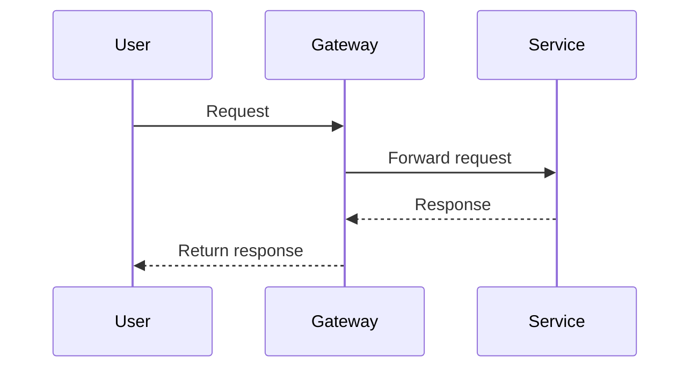

# CineMeow Feature Index & Roadmap

This page is the central index for tracking feature specifications, implementation status, architectural scope, and service dependencies across the CineMeow platform.

> [!TIP]
> Before implementing a new feature, register it here with a unique feature ID, identify the affected modules or services, and link its specification page.

---

## 1. Status Legend

| Status         | Definition                                                                              |
| -------------- | --------------------------------------------------------------------------------------- |
| 🟢 Live        | Fully implemented, tested, and running in the target environment.                       |
| 🟡 In Progress | Currently being implemented, tested, or reviewed.                                       |
| 🔵 Planned     | Requirements and acceptance criteria are defined and ready for implementation planning. |
| 🟣 In Design   | Requirements, architecture, data modeling, or API contracts are still being discussed.  |

---

## 2. Feature Catalog

### 2.1 Backend and Architecture

| Feature ID | Feature Title                                  | Target Modules / Services                                     | Status     | Specification                                                        |
| ---------- | ---------------------------------------------- | ------------------------------------------------------------- | ---------- | -------------------------------------------------------------------- |
| CM-000001  | Refactor Backend Services into a Parent Module | `core`, `profile`, `movie`, `cinema`, `showtime`, `promotion` | 🔵 Planned | [Feature Specification](Feature‐Refactor‐Backend‐Services‐CM‐000001) |

### 2.2 Frontend

| Feature ID | Feature Title                                                         | Target Modules / Services | Status  | Specification                                                                                   |
| ---------- | --------------------------------------------------------------------- | ------------------------- | ------- | ----------------------------------------------------------------------------------------------- |
| CM-000002  | Feature: Comprehensive Admin Portal UI/UX Refactoring & Design System | `frontend/admin`          | 🟢 Live | [Feature Specification](Feature‐Comprehensive‐Admin‐Portal‐Refactoring‐Design‐System‐CM‐000002) |

### 2.3 Cinema and Showtime

| Feature ID | Feature Title                       | Target Modules / Services  | Status  | Specification                                  |
| ---------- | ----------------------------------- | -------------------------- | ------- | ---------------------------------------------- |
| FEAT-003   | Cinema & Screen Topology Management | `cinema`, `frontend/admin` | 🟢 Live | [Cinema Management](Feature-Cinema-Management) |
| FEAT-004   | Dynamic Showtime Scheduling Engine  | `showtime`, `movie`        | 🟢 Live | [Showtime Management](Feature-Showtimes)       |

---

## 3. How to Register a New Feature

Follow these steps whenever a new feature is proposed.

1. **Assign a unique identifier.** Use the project's agreed naming convention and choose the next available ID. Do not reuse an existing ID.
2. **Define ownership.** Identify the affected backend modules, frontend applications, and external services.
3. **Create the specification page.** Use the naming convention `Feature-<Feature-Name>-<Feature-ID>`.
4. **Define the initial status.** Use `🟣 In Design` while requirements and technical decisions are being discussed.
5. **Document acceptance criteria.** Specify the expected behavior and conditions for completion.
6. **Add the feature to this index.** Include its ID, title, target modules or services, status, and specification link.
7. **Update the status as work progresses.** Change it to `🔵 Planned`, `🟡 In Progress`, and finally `🟢 Live` as appropriate.

### Feature ID Convention

Use one consistent ID convention for newly registered features.

Recommended format:

`CM-000001`, `CM-000002`, `CM-000003`, and so on.

Existing IDs such as `FEAT-003` and `FEAT-004` should remain unchanged unless the team explicitly decides to migrate the identifier convention.

---

## 4. Feature Specification Template

Create a separate Wiki page for each feature. Use the following template as the starting point.

### Feature Metadata

- **Feature ID:** `CM-XXXXXX`
- **Status:** 🟣 In Design
- **Target Modules / Services:** List affected modules and services.
- **Primary Owner:** Team or responsible developer.
- **Related Issues / Pull Requests:** Add links when available.

### 4.1 Overview and Business Value

Describe what the feature does, which problem it solves, and why it is needed.

### 4.2 Business Rules and Acceptance Criteria

- Rule 1: Describe the expected behavior.
- Rule 2: Describe validation and business constraints.
- Acceptance criteria: Define the conditions that must be satisfied before the feature is considered complete.

### 4.3 Architecture and Affected Components

- **APIs Exposed:** Document affected endpoints, HTTP methods, request formats, and response formats.
- **Events Published / Consumed:** Document relevant events, if applicable.
- **Database Changes:** Describe schema changes and migration scripts, if applicable.
- **Affected Modules:** List the modules that require changes.
- **Dependencies:** Identify dependencies on other features or external systems.

### 4.4 Sequence Diagram (Optional)

Add a Mermaid sequence diagram when the feature involves multiple components or services.

Example:

