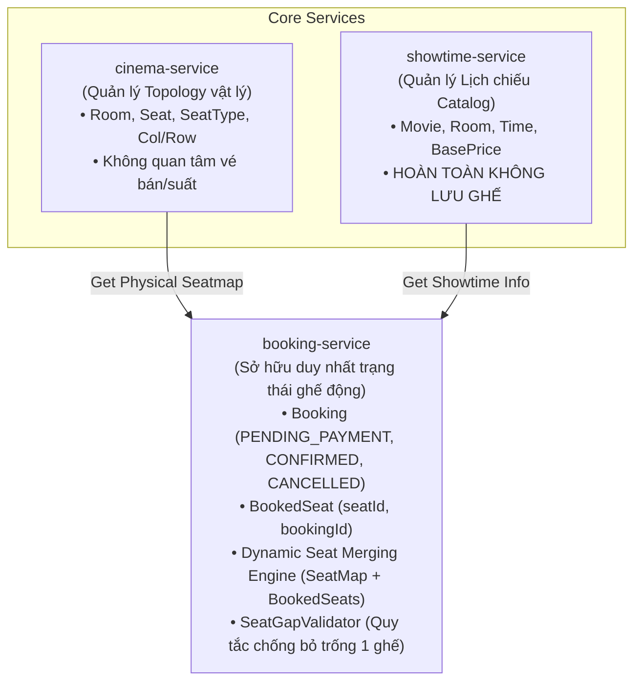
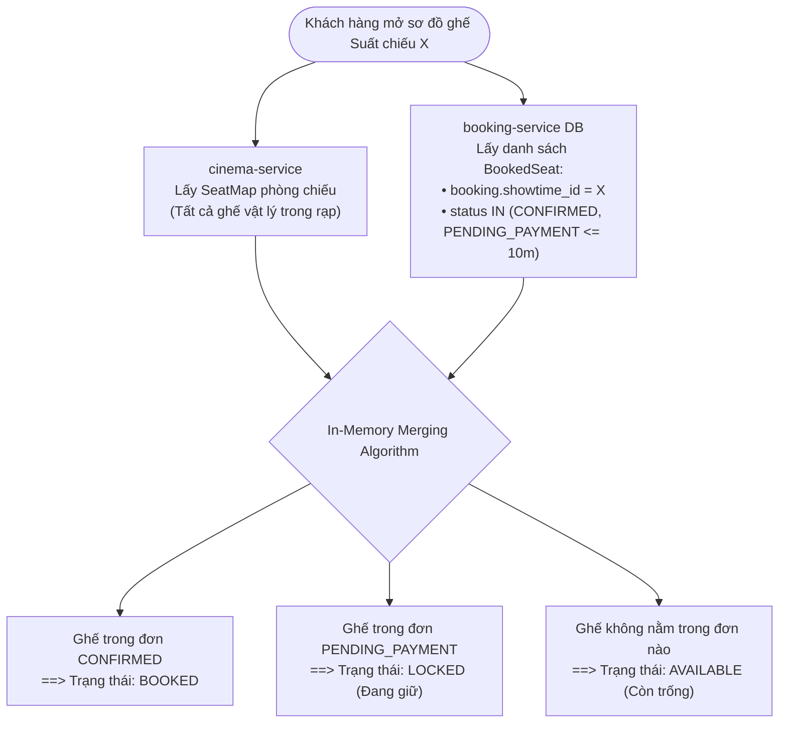

# Feature: Remove ShowtimeSeat & Unify Dynamic Seat Inventory in Booking Service

| Metadata | Details |
| :--- | :--- |
| **Feature ID** | CM-000005 |
| **Category** | Architecture / Technical Debt Reduction / Database Optimization |
| **Target Services** | `core/showtime-service`, `booking-service`, `core/cinema-service`, `client-frontend` |
| **Status** | 🟡 In Progress |
| **Priority** | P1 - High |
| **Author / Tech Lead** | Backend Core Team |

---

## 1. Overview

### 1.1 Purpose
Tái cấu trúc kiến trúc quản lý trạng thái ghế theo suất chiếu (Showtime Seat Inventory):
1. **Loại bỏ hoàn toàn bảng và entity `showtime_seat`** đang được khởi tạo trước (Eager Pre-allocation) tại `showtime-service`.
2. **Hợp nhất quyền quản lý trạng thái ghế động (Seat Availability & Holding Lifecycle)** về duy nhất **`booking-service`**, dựa trên chính các bản ghi `Booking` và `BookedSeat` hiện có.
3. **Bảo toàn và tối ưu hóa quy trình kiểm tra quy tắc không để trống 1 ghế (Single-Seat Gap Rule)** bằng cơ chế ánh xạ in-memory giữa sơ đồ ghế vật lý tĩnh (`Room Seatmap`) và các giao dịch đặt ghế động.

### 1.2 Background & Current Architectural Limitations
Trong thiết kế hiện tại của CineMeow:
* **Lãng phí tài nguyên lưu trữ nghiêm trọng (Storage Waste):** Mỗi khi tạo 1 suất chiếu mới (`Showtime`), hệ thống bắt buộc phải quét toàn bộ ghế của phòng chiếu và thực hiện `INSERT` trước 150 – 300 bản ghi `AVAILABLE` vào bảng `showtime_seat`. Với chuỗi 10 cụm rạp, 50 suất chiếu/ngày, hệ thống phải lưu trữ tới **~300.000 records/tháng**, trong khi tỷ lệ lấp đầy ghế (Occupancy Rate) trung bình thực tế chỉ khoảng 15% – 30%. Khoảng 70% – 85% bản ghi tồn tại vô nghĩa và không bao giờ được chạm tới.
* **Áp lực ghi I/O khi lập lịch chiếu:** Khi Admin lên lịch chiếu hàng loạt cho tuần/tháng, database liên tục bị nghẽn do hàng chục nghìn câu lệnh `INSERT` vào `showtime_seat`.
* **Trùng lặp dữ liệu (Data Redundancy Smell):** Cả `showtime-service` (bảng `showtime_seat`) và `booking-service` (bảng `booked_seats`) đều cùng lưu thông tin ghế (`seat_id`, `seat_label`, `seat_type`, `booking_id`). Điều này vi phạm nguyên tắc **Single Source of Truth (SSOT)** và tiềm ẩn nguy cơ bất đồng bộ dữ liệu giữa 2 microservices.
* **Lệch Bounded Context trong Domain-Driven Design (DDD):** Trạng thái `LOCKED` (giữ chỗ tạm) hay `BOOKED` (đã mua) thực chất là **trạng thái của một giao dịch đặt vé (Booking Lifecycle)**, không phải là thuộc tính bất biến của Suất chiếu (Catalog/Schedule). Việc `showtime-service` phải gánh vác việc khóa ghế và mở khóa ghế làm tăng Network Hops và tạo ra nút thắt cổ chai (bottleneck) khi có phim bom tấn mở bán.

---

## 2. Goals & Success Metrics

- **Mục tiêu kỹ thuật & lưu trữ:**
  - Giảm **100%** số lượng bản ghi `showtime_seat` dư thừa khi tạo mới suất chiếu.
  - Tốc độ tạo suất chiếu (`POST /showtimes`) giảm từ ~250ms xuống **< 15ms** (chỉ còn 1 câu lệnh `INSERT INTO showtimes`).
  - Xóa bỏ hoàn toàn tình trạng duplicate giữa `showtime_seat` và `booked_seats`.
- **Mục tiêu tính đúng đắn & nghiệp vụ:**
  - Quy tắc chống bỏ trống 1 ghế đơn độc (**Single-Seat Gap Rule**) tiếp tục hoạt động chính xác 100% tại `booking-service`.
  - Tự động giải phóng ghế hết hạn giữ chỗ (Auto-expire holding seats sau 10 phút) thông qua điều kiện thời gian thực của `Booking`, không cần scheduler quét DB định kỳ.
- **Success Metrics:**
  - Zero downtime trong quá trình chuyển dịch dữ liệu.
  - Latency của API kiểm tra sơ đồ ghế `GET /bookings/showtimes/{id}/seats` đạt **< 50ms**.

---

## 3. Scope

| In Scope | Out of Scope |
| :--- | :--- |
| • Xóa bỏ entity, service, controller và repository `ShowtimeSeat` tại `core/showtime-service`.<br>• Ngừng gọi `initializeSeatsForShowtime` khi tạo suất chiếu.<br>• Xây dựng API tổng hợp trạng thái ghế theo suất chiếu tại `booking-service`.<br>• Di chuyển và tích hợp `SeatGapValidator` vào `booking-service`.<br>• Cập nhật `client-frontend` gọi API lấy trạng thái ghế từ `booking-service`. | • Tích hợp Redis Distributed Caching / Redis Lock (sẽ thực hiện ở Phase sau cho kịch bản High Concurrency P0).<br>• Thay đổi cấu trúc bảng vật lý `seats` và `rooms` của `cinema-service`.<br>• Thay đổi giao diện UI phòng vé phía Frontend. |

---

## 4. Architecture & Technical Design

### 4.1 Bóc tách vai trò các Services sau tái cấu trúc



1. **`core/cinema-service` (Static Topology):** Lưu giữ sơ đồ phòng chiếu và tọa độ vật lý của từng ghế (`rowIndex`, `colIndex`, `type`, `label`). Dữ liệu này cố định và không thay đổi theo từng suất chiếu.
2. **`core/showtime-service` (Schedule Catalog):** Chỉ lưu thông tin suất chiếu (`id`, `movieId`, `roomId`, `startTime`, `endTime`, `status`). Hoàn toàn không lưu hay quản lý ghế.
3. **`booking-service` (Dynamic Inventory & Transaction):** Quản lý toàn bộ trạng thái đặt chỗ. Trạng thái của một chiếc ghế đối với một suất chiếu được xác định tự động thông qua các bản ghi `Booking` đang active.

---

### 4.2 Cơ chế xác định trạng thái ghế (Dynamic Status Merging)

Không cần bảng `showtime_seat`, trạng thái ghế được suy diễn theo quy tắc:



#### SQL Query lấy ghế đang chiếm dụng tại `booking-service`:
```sql
SELECT bs.seat_id, b.status, b.created_at
FROM booked_seats bs
JOIN booking b ON bs.booking_id = b.id
WHERE b.showtime_id = :showtimeId
  AND (
      b.status = 'CONFIRMED'
      OR (b.status = 'PENDING_PAYMENT' AND b.created_at >= :expireThreshold)
  );
```
*(Trong đó `:expireThreshold = LocalDateTime.now().minusMinutes(10)`)*

---

### 4.3 Giải pháp kiểm tra Quy tắc ghế trống (Single-Seat Gap Validation)

Nghiệp vụ Single-Seat Gap đòi hỏi phải biết **toàn bộ ma trận ghế của cả hàng** (bao gồm cả ghế trống, ghế đã bán, lối đi `EMPTY` và tường biên). 

Khi không còn bảng `showtime_seat`, việc xác thực được giải quyết sạch sẽ thông qua 4 bước:

1. **Thu thập ma trận tọa độ:** `booking-service` gọi `cinemaClient.getSeatMap(showtime.getRoomId())` để lấy toàn bộ danh sách `SeatResponse` gồm `id, label, rowIndex, colIndex, type`.
2. **Ánh xạ trạng thái động:** Thực hiện hàm merge ở mục 4.2 để gán trạng thái (`AVAILABLE`, `LOCKED`, hoặc `BOOKED`) cho từng chiếc ghế vật lý.
3. **Khởi tạo danh sách `SeatPosition`:**
   ```java
   List<SeatPosition> roomPositions = roomSeats.stream()
       .map(s -> SeatPosition.builder()
           .seatId(s.getId())
           .label(s.getLabel())
           .rowIndex(s.getRowIndex())
           .colIndex(s.getColIndex())
           .type(s.getType())
           .status(occupiedSeatMap.getOrDefault(s.getId(), SeatStatus.AVAILABLE))
           .build())
       .toList();
   ```
4. **Thực thi Validator:** Gọi trực tiếp `seatGapValidator.validate(roomPositions, selectedSeatIds)`.
   - Nếu vi phạm (để lại 1 ghế trống đơn độc) $\rightarrow$ Ném ngoại lệ `AppException(ErrorCode.SINGLE_SEAT_GAP_VIOLATION)`.
   - Nếu hợp lệ $\rightarrow$ Cho phép tiến hành tạo `Booking` ở trạng thái `PENDING_PAYMENT`.

> [!NOTE]
> `SeatGapValidator` là thuật toán thuần túy tính toán in-memory dựa trên tọa độ `(rowIndex, colIndex)` và trạng thái `AVAILABLE / OCCUPIED`. Bản chất thuật toán không phụ thuộc vào việc dữ liệu lấy từ bảng `showtime_seat` hay từ phép ánh xạ `booked_seats + seatMap`.

---

### 4.4 API Contracts

#### 1. Lấy trạng thái ghế theo suất chiếu (Gọi từ Frontend)
```http
GET /api/v1/bookings/showtimes/{showtimeId}/seats
Accept: application/json
```
**Response (200 OK):**
```json
{
  "code": 1000,
  "message": "Success",
  "data": [
    {
      "seatId": 101,
      "label": "A1",
      "status": "BOOKED"
    },
    {
      "seatId": 102,
      "label": "A2",
      "status": "LOCKED",
      "reservedUntil": "2026-11-10T22:30:00"
    }
  ]
}
```
*(Chỉ trả về các ghế đang `BOOKED` hoặc `LOCKED`. Frontend tự đối chiếu với `seatMap` phòng, các ghế không có trong response hiển thị màu xanh `AVAILABLE`).*

#### 2. Khởi tạo giữ ghế & Kiểm tra Single-Seat Gap
```http
POST /api/v1/bookings/reserve
Content-Type: application/json

{
  "showtimeId": "st-uuid-1234",
  "seatIds": [103, 104]
}
```

---

## 5. Implementation Roadmap

### Phase 1: Chuẩn bị & Chuyển giao Validator
- [ ] Chuyển class `SeatGapValidator.java` và các DTO (`SeatPosition`, `GapValidationResult`) sang `booking-service` (hoặc module `common-library`).
- [ ] Bổ sung FeignClient `CinemaClient.getSeatMap(roomId)` trong `booking-service`.
- [ ] Viết Unit Test cho logic ánh xạ in-memory `DynamicSeatInventoryServiceTest`.

### Phase 2: Triển khai API tại Booking Service & Cập nhật Client
- [ ] Viết API `GET /bookings/showtimes/{showtimeId}/seats` tại `booking-service`.
- [ ] Tích hợp `SeatGapValidator` vào luồng `createBooking` (`POST /bookings`).
- [ ] Cập nhật `client-frontend`: đổi endpoint query trạng thái ghế sang `booking-service`.
- [ ] Chạy kiểm thử End-to-End luồng đặt vé: Chọn ghế $\rightarrow$ Giữ chỗ $\rightarrow$ Kiểm tra vi phạm 1 ghế $\rightarrow$ Thanh toán $\rightarrow$ Xác nhận ghế.

### Phase 3: Dọn dẹp Showtime Service & Database Migration
- [ ] Xóa dòng gọi `initializeSeatsForShowtime` trong `ShowtimeServiceImpl.create`.
- [ ] Xóa bỏ `ShowtimeSeatController`, `ShowtimeSeatServiceImpl`, `ShowtimeSeatRepository` và entity `ShowtimeSeat`.
- [ ] Viết script migration DB (Flyway `V4__drop_showtime_seat_table.sql`) để drop bảng `showtime_seat`.

---

## 6. Risks & Mitigation

| Rủi ro kỹ thuật | Mức độ | Biện pháp giảm thiểu |
| :--- | :---: | :--- |
| **Hiệu năng câu query JOIN `booked_seats` và `booking`** khi bảng `booking` phình to | Medium | Đánh chỉ mục kép (Composite Index) trên bảng `booking(showtime_id, status, created_at)` và `booked_seats(booking_id, seat_id)`. Query này sẽ hoàn toàn chạy trên Index Range Scan. |
| **Tranh chấp giữ ghế đồng thời (Race Condition)** khi 2 người cùng chọn 1 ghế | High | Đặt Unique Constraint trên `(booking.showtime_id, booked_seats.seat_id)` đối với các booking chưa bị CANCELLED, hoặc bổ sung Redis Atomic Lock (`SETNX`) ở pha mở rộng tiếp theo. |
| **Phụ thuộc mạng vào `cinema-service`** để lấy sơ đồ ghế phòng | Low | Áp dụng `@Cacheable(value = "seat_map", key = "#roomId")` tại `booking-service` vì sơ đồ vật lý của phòng chiếu gần như không đổi theo thời gian. |

---

## 7. Definition of Done (DoD)

- [ ] Suất chiếu mới được tạo ra mà **không sinh bất kỳ bản ghi nào** trong bảng ghế.
- [ ] `booking-service` trả về đúng danh sách ghế `LOCKED` và `BOOKED` của suất chiếu.
- [ ] Ghế hết hạn thanh toán (sau 10 phút) tự động giải phóng về trạng thái `AVAILABLE`.
- [ ] Thuật toán `SeatGapValidator` hoạt động chính xác, chặn thành công các hành vi để lại 1 ghế đơn độc.
- [ ] Toàn bộ code cũ liên quan đến `showtime_seat` trong `core/showtime-service` được dọn dẹp sạch sẽ.
- [ ] Bộ kiểm thử Unit & Integration test đạt độ bao phủ $\ge 85\%$.
- [ ] Cập nhật trạng thái `CM-000005` trong `docs/wiki/Feature-Index.md`.

