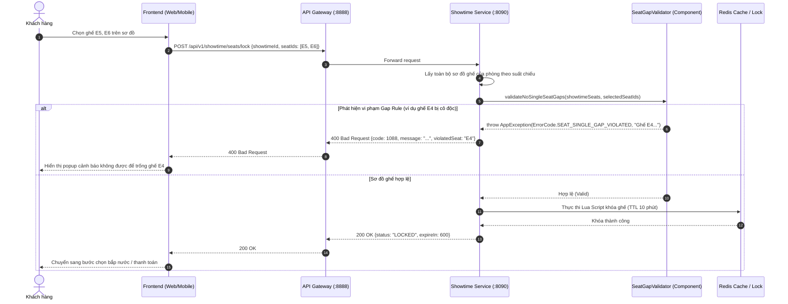

# Feature: Single-Seat Gap Prevention Rule (Chống bỏ trống 1 ghế đơn độc)

| Metadata          | Details                                                            |
| :---------------- | :----------------------------------------------------------------- |
| **Feature ID**    | CM-000004                                                          |
| **Category**      | Business Feature / Revenue Optimization / Cinema & Showtime        |
| **Target Scope**  | `core/showtime-service`, `booking-service`, `client-frontend`      |
| **Status**        | 🟢 Live                                                            |
| **Priority**      | P1 - High                                                          |
| **Primary Owner** | Backend Core Team                                                  |

---

## 1. Overview

### 1.1 Purpose
Triển khai thuật toán kiểm soát sơ đồ ghế nhằm **ngăn chặn người dùng đặt vé để lại một ghế trống duy nhất cô độc** (Single Empty Seat Gap) trong cùng một hàng ghế. Đây là quy tắc tiêu chuẩn vàng (Golden Rule) của tất cả các hệ thống rạp chiếu phim hàng đầu (CGV, Lotte, BHD, Galaxy) nhằm tối ưu hóa tỷ lệ lấp đầy phòng chiếu (Occupancy Rate) và bảo vệ doanh thu cho rạp.

### 1.2 Background & Business Problem
Trong thói quen xem phim chiếu rạp:
* Khách hàng đi xem phim thường đi theo **cặp (2 người)** hoặc **nhóm bạn/gia đình (3-4 người trở lên)**. Tỷ lệ khách đi xem phim 1 mình rất thấp (thường < 5%).
* Khi một khách hàng chọn mua ghế tạo ra một ghế trống đơn độc (ví dụ hàng 10 ghế: ghế 1-2-3 đã bán, khách chọn 5-6 $\rightarrow$ để lại ghế số 4 trống trơ trọi giữa ghế số 3 và số 5):
  * Ghế số 4 gần như **không thể bán được** cho khách đến sau.
  * Khi các cặp đôi hoặc gia đình vào đặt vé, họ thấy ghế trống bị chia cắt và sẽ bỏ sang rạp khác hoặc chọn suất chiếu khác.
  * Điều này gây lãng phí tài nguyên phòng chiếu và gây thất thoát doanh thu đáng kể cho rạp chiếu phim (lên tới 10-15% tổng doanh thu mỗi suất chiếu).

---

## 2. Goals & Success Metrics

- **Mục tiêu nghiệp vụ:**
  - Ngăn chặn 100% các thao tác chọn ghế tạo ra ghế trống đơn độc (`gap_size == 1`) trước khi tiến hành giữ ghế (Seat Holding) hoặc tạo đơn đặt vé.
  - Phản hồi thông báo lỗi rõ ràng, chỉ rõ vị trí ghế vi phạm (ví dụ: *"Ghế E4 không được để trống đơn độc. Vui lòng chọn ghế liền kề hoặc cách ít nhất 2 ghế"*).
- **Mục tiêu kỹ thuật:**
  - Thuật toán kiểm tra phải thuần túy in-memory, độ phức tạp thời gian $\mathcal{O}(N)$ hoặc $\mathcal{O}(N \log N)$ trên một hàng ghế ($N \le 30$ ghế).
  - Thời gian thực thi kiểm tra phải dưới **1 mili-giây** ($< 1\text{ ms}$), không làm tăng độ trễ của API giữ ghế / đặt vé.
- **Success Metric:**
  - 0 trường hợp ghế mồ côi phát sinh từ thao tác người dùng.
  - 100% test cases bao phủ đầy đủ các điều kiện biên (vách tường, lối đi, ghế đôi, ghế lẻ cuối cùng).

---

## 3. Business Rules & Boundary Matrix

### 3.1 Định nghĩa trạng thái ghế trong hàng
Trong một hàng ghế, mỗi vị trí có thể có một trong các trạng thái sau:
1. `OCCUPIED`: Ghế đã có người mua (`BOOKED`), đang bị người khác giữ (`HELD`), hoặc **đang được chọn bởi người dùng trong request hiện tại**.
2. `AVAILABLE`: Ghế còn trống, hợp lệ để mua.
3. `BARRIER`: Ranh giới vật lý không thể đặt ghế, bao gồm:
   - Mép tường bên trái và mép tường bên phải của hàng ghế.
   - Khoảng trống lối đi giữa các khối ghế (`SeatType.EMPTY`).

### 3.2 Quy tắc cốt lõi (The Core Invariant)
> [!IMPORTANT]
> **Quy tắc:** Thao tác chọn ghế **BỊ TỪ CHỐI** nếu sau khi mô phỏng việc đặt các ghế đã chọn, tồn tại bất kỳ khối ghế trống (`AVAILABLE`) liên tiếp nào có số lượng đúng bằng **1** (`gap_length == 1`) nằm giữa hai ranh giới (`BARRIER` hoặc `OCCUPIED`).

### 3.3 Ma trận kịch bản kiểm tra (Test Scenario Matrix)

| Kịch bản | Minh họa hàng ghế trước khi chọn | Khách chọn | Trạng thái sau mô phỏng | Kết quả | Lý do |
| :---: | :--- | :---: | :--- | :---: | :--- |
| **Case 1** | `[O, O, O, ., ., ., ., ., ., .]` | Ghế 5, 6 | `[O, O, O, ., X, X, ., ., ., .]` | ❌ **CHẶN** | Ghế 4 bị cô độc giữa ghế 3 (đã bán) và ghế 5 (đang chọn). |
| **Case 2** | `[., ., ., ., ., ., ., ., ., .]` | Ghế 2, 3 | `[., X, X, ., ., ., ., ., ., .]` | ❌ **CHẶN** | Ghế 1 bị cô độc sát vách tường trái. |
| **Case 3** | `[., ., ., ., ., ., ., ., ., .]` | Ghế 8, 9 | `[., ., ., ., ., ., ., X, X, .]` | ❌ **CHẶN** | Ghế 10 bị cô độc sát vách tường phải. |
| **Case 4** | `[O, O, O, ., ., ., ., ., ., .]` | Ghế 4, 5 | `[O, O, O, X, X, ., ., ., ., .]` | ✅ **HỢP LỆ** | Không để lại ghế lẻ nào. Còn lại cụm 5 ghế trống `[6-10]`. |
| **Case 5** | `[O, O, O, ., ., ., ., ., ., .]` | Ghế 6, 7 | `[O, O, O, ., ., X, X, ., ., .]` | ✅ **HỢP LỆ** | Còn lại cụm 2 ghế trống `[4, 5]` và cụm 3 ghế trống `[8, 9, 10]`. |
| **Case 6** | `[O, O, O, ., O, O, O, O, O, O]` | Ghế 4 | `[O, O, O, X, O, O, O, O, O, O]` | ✅ **HỢP LỆ** | Ghế 4 vốn đã là ghế lẻ từ trước, khách mua nốt ghế 4 sẽ xóa bỏ ghế lẻ! |
| **Case 7** | `[., ., AISLE, ., ., ., ., ., .]` | Ghế 2 | `[., X, AISLE, ., ., ., ., ., .]` | ❌ **CHẶN** | Ghế 1 bị cô độc giữa vách tường trái và lối đi. |
| **Case 8** | `[., ., AISLE, ., ., ., ., ., .]` | Ghế 4 | `[., ., AISLE, X, ., ., ., ., .]` | ❌ **CHẶN** | Khách chọn ghế 4 sát lối đi, để lại cụm phía sau hợp lệ. |

*(Ký hiệu: `.` là ghế trống khả dụng, `O` là ghế đã bán/đã giữ, `X` là ghế khách đang chọn mua, `AISLE` là lối đi)*.

### 3.4 Các trường hợp ngoại lệ (Exceptions & Exemptions)
1. **Ghế cô độc đã tồn tại sẵn từ trước (Pre-existing Orphan Seat):**
   Nếu trước khi khách đặt vé, trong hàng đã tồn tại sẵn một ghế lẻ (do lịch sử để lại), thì:
   * Nếu khách chọn mua **chính chiếc ghế lẻ đó**: ✅ **Cho phép** (vì hành động này giúp lấp đầy ghế lẻ).
   * Nếu khách chọn cụm ghế khác mà **không làm phát sinh thêm bất kỳ ghế lẻ mới nào**: ✅ **Cho phép**.
2. **Khách hàng chọn nhiều hàng cùng lúc (Multi-row Selection):**
   * Thuật toán sẽ nhóm danh sách ghế theo từng hàng (`rowIndex`) và kiểm tra độc lập từng hàng một. Nếu có bất kỳ hàng nào vi phạm $\rightarrow$ Hủy toàn bộ thao tác.
3. **Ghế đôi (Sweetbox):**
   * Ghế đôi luôn có kích thước là 2 chỗ liền kề và không bao giờ tạo thành ghế lẻ kích thước 1.

---

## 4. Architecture & Technical Design

### 4.1 Luồng xử lý dữ liệu (Sequence Diagram)



### 4.2 Thiết kế Component & Class Diagram

Thuật toán được đóng gói thành một Spring Component độc lập bên trong `core/showtime-service`:

```text
com.cinemeow.showtime_service/
├── validator/
│   ├── SeatGapValidator.java          <-- Engine kiểm tra quy tắc Gap
│   └── model/
│       ├── RowSeatSimulation.java      <-- Model mô phỏng 1 hàng ghế
│       └── GapValidationResult.java    <-- Kết quả kiểm tra (isPassed, violatedSeatLabel)
├── service/
│   └── impl/
│       ├── ShowtimeSeatServiceImpl.java <-- Tích hợp gọi SeatGapValidator
│       └── ShowtimeServiceImpl.java
└── exception/
    └── ErrorCode.java                  <-- Mã lỗi SEAT_SINGLE_GAP_VIOLATED
```

### 4.3 Đặc tả Thuật toán (Algorithm Specification)

Thuật toán hoạt động theo nguyên lý **1D Segment Simulation**:

```java
public class SeatGapValidator {

    public void validate(List<ShowtimeSeat> allSeatsInShowtime, List<Long> selectedSeatIds) {
        // Bước 1: Nhóm danh sách ghế theo từng hàng (rowIndex)
        Map<Integer, List<ShowtimeSeat>> seatsByRow = allSeatsInShowtime.stream()
                .collect(Collectors.groupingBy(ShowtimeSeat::getRowIndex));

        Set<Long> selectedSet = new HashSet<>(selectedSeatIds);

        // Bước 2: Duyệt qua các hàng có chứa ghế được chọn
        for (Map.Entry<Integer, List<ShowtimeSeat>> entry : seatsByRow.entrySet()) {
            List<ShowtimeSeat> rowSeats = entry.getValue();
            boolean rowHasSelectedSeat = rowSeats.stream().anyMatch(s -> selectedSet.contains(s.getSeatId()));
            if (!rowHasSelectedSeat) continue;

            // Sắp xếp ghế theo thứ tự cột từ trái qua phải (colIndex)
            rowSeats.sort(Comparator.comparingInt(ShowtimeSeat::getColIndex));

            // Bước 3: Đếm số lượng ghế đơn độc TRƯỚC và SAU khi chọn
            int orphanBefore = countSingleSeatGaps(rowSeats, Collections.emptySet());
            int orphanAfter = countSingleSeatGaps(rowSeats, selectedSet);

            // Bước 4: Nếu thao tác làm TĂNG số lượng ghế đơn độc -> Vi phạm!
            if (orphanAfter > orphanBefore) {
                String violatedSeatLabel = findFirstViolatedOrphanSeat(rowSeats, selectedSet);
                throw new AppException(ErrorCode.SEAT_SINGLE_GAP_VIOLATED, 
                        "Không thể để trống 1 ghế đơn độc (" + violatedSeatLabel + ")");
            }
        }
    }
}
```

### 4.4 API Error Contract

Khi vi phạm quy tắc, API trả về mã lỗi chuẩn trong hệ thống CineMeow:

```http
HTTP/1.1 400 Bad Request
Content-Type: application/json

{
  "code": 1088,
  "message": "Không thể để trống 1 ghế đơn độc (Ghế E4). Vui lòng chọn ghế liền kề hoặc cách ít nhất 2 ghế.",
  "data": {
    "violatedSeatId": 254,
    "violatedSeatLabel": "E4",
    "rowIndex": 4,
    "colIndex": 3
  }
}
```

---

## 5. Implementation Roadmap

### Phase 1: Core Algorithm & Unit Tests (1-2 ngày)
- [x] Xây dựng enum / model phân loại trạng thái logic cho ghế (`SeatPosition`, `GapValidationResult`).
- [x] Xây dựng class `SeatGapValidator` với thuật toán quét mảng 1D Segment Simulation.
- [x] Thêm mã lỗi `SEAT_SINGLE_GAP_VIOLATED(1088, ...)` vào `ErrorCode.java`.
- [x] Viết bộ Unit Test đầy đủ (`SeatGapValidatorTest`) bao phủ 100% các case trong ma trận kiểm thử:
  - [x] Test case: Hàng bình thường để lại 1 ghế trống.
  - [x] Test case: Để lại 1 ghế trống sát vách tường bên trái / bên phải.
  - [x] Test case: Để lại 1 ghế trống sát lối đi (`SeatType.EMPTY`).
  - [x] Test case: Mua ghế lẻ đã tồn tại từ trước (hợp lệ).
  - [x] Test case: Mua cụm 2-3 ghế hợp lệ.

### Phase 2: Tích hợp vào Showtime Service (1 ngày)
- [x] Inject `SeatGapValidator` vào `ShowtimeSeatServiceImpl` tại API `/seats/lock` và `/seats/check`.
- [x] Đảm bảo việc kiểm tra `SeatGapValidator` diễn ra **trước** khi giữ ghế (Fail-fast).
- [x] Chạy kiểm thử đơn vị dịch vụ (`ShowtimeSeatServiceImplTest`) kiểm tra toàn luồng kiểm tra ghế.

### Phase 3: Đồng bộ Frontend UX (1 ngày)
- [x] Bắt mã lỗi `1088` tại frontend (`client-frontend`).
- [x] Hiển thị thông báo Toast cảnh báo trực quan cho khách hàng trên sơ đồ ghế.
- [x] Highlight viền đỏ chiếc ghế bị cô độc để khách hàng nhận biết ngay tức thì.

---

## 6. Risks & Mitigation

| Rủi ro kỹ thuật | Mức độ | Giải pháp phòng ngừa (Mitigation) |
| :--- | :---: | :--- |
| **Sơ đồ ghế đặc thù (Hình chữ U, hàng ghế lệch)** | Trung bình | Dựa trên `rowIndex` và `colIndex` vật lý được lưu trong Database, coi mọi khoảng trống `SeatType.EMPTY` là một rào cản phân tách khối độc lập. |
| **Ảnh hưởng hiệu năng API Lock ghế** | Thấp | Thuật toán quét mảng 1 chiều in-memory chỉ tốn $< 0.1\text{ ms}$, hoàn toàn không gọi thêm bất kỳ câu truy vấn Database nào khác. |
| **Trải nghiệm khách hàng khó chịu khi bị chặn** | Trung bình | Thông báo lỗi phải gợi ý hướng giải quyết thân thiện (ví dụ: *"Bạn có muốn chọn thêm ghế E4 không?"* hoặc *"Vui lòng lùi sang một ghế"*). |

---

## 7. Definition of Done (DoD)

- [x] Thuật toán `SeatGapValidator` được triển khai hoàn chỉnh trong `core/showtime-service`.
- [x] Bộ Unit Test `SeatGapValidatorTest` đạt độ bao phủ $\ge 90\%$ code coverage (10/10 case passed).
- [x] API `/seats/lock` và `/seats/check` từ chối giữ ghế nếu vi phạm kèm mã lỗi `1088`.
- [ ] Tài liệu Wiki và `Feature-Index.md` được cập nhật trạng thái `🟢 Live` sau khi hoàn thành.

