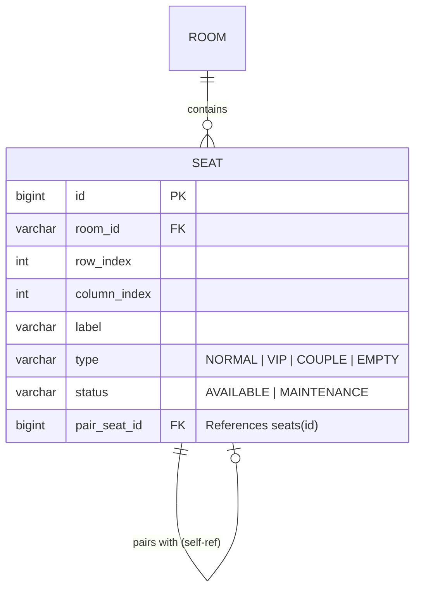
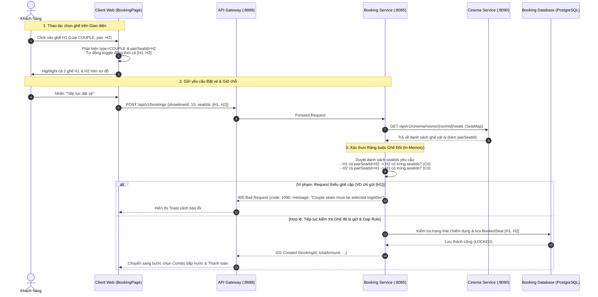

# Feature: Ràng buộc Nguyên tử cho Ghế Đôi Sweetbox (Couple Seat Atomic Constraint)

| Metadata | Details |
| :--- | :--- |
| **Feature ID** | CM-000008 |
| **Category** | Core Domain Feature / Seat Inventory / Business Invariant |
| **Target Services** | `core/cinema-service`, `booking-service`, `frontend/client-frontend`, `frontend/admin-frontend` |
| **Status** | 🟣 In Design |
| **Priority** | P1 - High |
| **Author / Tech Lead** | Backend Core Team |

---

## 1. Overview

### 1.1 Purpose
Thiết lập cơ chế toàn vẹn nguyên tử cho loại ghế đôi (**Sweetbox / Couple Seat Atomic Invariant**):
1. **Bảo toàn tính bất khả phân (Non-divisible Pair Invariant):** Đảm bảo hai ghế thuộc cùng một cặp Sweetbox luôn được chọn, giữ chỗ (hold), đặt vé (book), hủy bỏ (cancel) và định giá như một thực thể thống nhất (Atomic Entity).
2. **Loại bỏ triệt để hiện tượng ghế mồ côi một nửa (Half-broken Couple Seat):** Ngăn chặn tuyệt đối việc người dùng (vô tình qua UI hoặc cố ý qua API thô) chỉ mua lẻ 1 ghế trong cặp ghế đôi, làm ghế còn lại bị bỏ hoang không thể bán được.
3. **Đồng bộ hóa trải nghiệm người dùng 2 chiều (End-to-End Pair Selection):**
   - **Frontend:** Khi khách hàng click chọn 1 ghế Sweetbox trên giao diện sơ đồ phòng chiếu, hệ thống tự động chọn luôn chiếc ghế ghép cặp tương ứng.
   - **Backend:** Cơ chế xác thực đa tầng (Defense-in-Depth) tại `booking-service` tự động từ chối mọi request không hợp lệ nếu thiếu nửa kia của cặp đôi.

### 1.2 Background & Business Problem
Tại các rạp chiếu phim hiện đại của CineMeow:
* **Đặc thù vật lý của ghế Sweetbox:** Ghế đôi Sweetbox thường được bố trí ở hàng ghế sau cùng của phòng chiếu. Đây là băng ghế liền khối dành cho 2 người, có vách ngăn hai bên tạo không gian riêng tư và không có thanh để tay ngăn cách ở giữa.
* **Vấn đề khi thiếu ràng buộc ghép cặp:**
  * Hiện tại trong Database `core/cinema-service`, bảng `seats` chỉ lưu thuộc tính `type = 'COUPLE'`, nhưng **không hề có con trỏ hoặc định danh liên kết (`pair_seat_id`)** giữa 2 ghế tạo nên chiếc Sweetbox đó.
  * Khi người dùng truy cập màn hình đặt vé `BookingPage.jsx`, họ có thể click chọn riêng ghế `H1` mà không chọn `H2`.
  * Khi gửi request `POST /api/v1/bookings` với `seatIds: [H1]`, backend hiện tại vẫn chấp nhận và lưu vào cơ sở dữ liệu.
* **Hậu quả kinh doanh nghiêm trọng:**
  * **Thiệt hại doanh thu:** Ghế `H2` còn lại không thể bán cho một cặp đôi khác (vì không ai đi 2 người lại muốn ngồi chung vách Sweetbox với một người lạ). Ghế đơn lẻ cũng rất hiếm khi được khách đi 1 mình chọn ở hàng Sweetbox.
  * **Phá vỡ trải nghiệm khách hàng:** Dẫn đến xung đột chỗ ngồi khi khách đến rạp và phát hiện chiếc ghế đôi lãng mạn bị chia đôi cho 2 người hoàn toàn xa lạ.

---

## 2. Goals & Success Metrics

- **Mục tiêu nghiệp vụ & vận hành:**
  - **100% nguyên tử:** Không bao giờ tồn tại trạng thái một chiếc ghế Sweetbox bị mua hoặc giữ lẻ loi trong bất kỳ suất chiếu nào.
  - Tự động gắn kết 2 ghế cặp đôi trong mọi thao tác: Chọn ghế (Select), Khóa giữ chỗ (Lock/Hold), Thanh toán thành công (Paid/Booked), Giải phóng hết hạn (Release/Expire), hoặc Hoàn hủy (Refund).
  - Tích hợp chuẩn xác với thuật toán chống bỏ trống 1 ghế [CM-000004 Single-Seat Gap Rule](Feature-Single-Seat-Gap-Rule).
- **Mục tiêu kỹ thuật:**
  - Thiết lập mối quan hệ tự tham chiếu đối xứng (Symmetric Self-Referencing Relation) qua cột `pair_seat_id` trong bảng `seats`.
  - Độ trễ kiểm tra hợp lệ ghế đôi tại `booking-service` đạt **$< 0.5\text{ ms}$** (tra cứu trực tiếp in-memory thông qua bảng băm `physicalSeatMap`).
- **Success Metrics:**
  - 0 giao dịch đặt vé ghế đôi bị khuyết nửa xuất hiện trong hệ thống.
  - Phản hồi mã lỗi rõ ràng (`1090 - SEAT_COUPLE_PAIR_INCOMPLETE`) khi request cố tình gửi lẻ ghế đôi.

---

## 3. Business Rules & Mathematical Model

### 3.1 Định nghĩa Cặp ghế Đôi (Sweetbox Pair Definition)
Gọi không gian toàn bộ các ghế vật lý trong phòng chiếu là $\mathcal{S}$.
Mỗi ghế $s \in \mathcal{S}$ có:
- Định danh duy nhất: $s.\text{id}$
- Loại ghế: $s.\text{type} \in \{\text{NORMAL}, \text{VIP}, \text{COUPLE}, \text{EMPTY}\}$
- Con trỏ ghế cặp đôi: $s.\text{pair\_seat\_id} \in \mathbb{N} \cup \{\text{NULL}\}$

> [!IMPORTANT]
> **Tính chất Đối xứng Bắt buộc (Symmetric Invariant):**
> Đối với mọi ghế đôi ($s.\text{type} = \text{COUPLE}$), bắt buộc tồn tại duy nhất một ghế đối ứng $s' \in \mathcal{S}$ sao cho:
> $$s.\text{pair\_seat\_id} = s'.\text{id} \quad \Longleftrightarrow \quad s'.\text{pair\_seat\_id} = s.\text{id}$$
> Đồng thời $s$ và $s'$ phải cùng thuộc một phòng chiếu ($s.\text{room\_id} = s'.\text{room\_id}$) và cùng nằm trên một hàng ($s.\text{row\_index} = s'.\text{row\_index}$).

### 3.2 Quy tắc Toàn vẹn Lựa chọn Ghế (Selection Atomic Invariant)
Gọi tập hợp các ghế mà người dùng gửi lên trong yêu cầu đặt vé là $\mathcal{S}_{\text{req}} \subseteq \mathcal{S}$.
Quy tắc hợp lệ được định nghĩa như sau:

$$\forall s \in \mathcal{S}_{\text{req}}, \quad (s.\text{type} = \text{COUPLE}) \implies (s.\text{pair\_seat\_id} \in \mathcal{S}_{\text{req}})$$

Nếu tồn tại bất kỳ ghế nào thuộc $\mathcal{S}_{\text{req}}$ vi phạm điều kiện trên, hệ thống **LẬP TỨC TỪ CHỐI** toàn bộ giao dịch.

### 3.3 Ma trận Kịch bản Kiểm thử (Test Scenario Matrix)

Giả sử hàng ghế `H` có cặp ghế đôi $H_1 \leftrightarrow H_2$ và $H_3 \leftrightarrow H_4$, cùng các ghế đơn $H_5, H_6$:

| Kịch bản | Danh sách ghế gửi lên $\mathcal{S}_{\text{req}}$ | Kết quả | Mã lỗi / Trạng thái | Giải thích nghiệp vụ |
| :---: | :--- | :---: | :---: | :--- |
| **TC-01** | `[H1, H2]` |  **HỢP LỆ** | 200 OK | Chọn đầy đủ cả cặp Sweetbox $H_1$ và $H_2$. |
| **TC-02** | `[H1]` | ❌ **TỪ CHỐI** | 1090 Conflict | Chỉ chọn $H_1$, thiếu ghế cặp $H_2$. |
| **TC-03** | `[H2]` | ❌ **TỪ CHỐI** | 1090 Conflict | Chỉ chọn $H_2$, thiếu ghế cặp $H_1$. |
| **TC-04** | `[H1, H2, H3, H4]` |  **HỢP LỆ** | 200 OK | Chọn 2 cặp Sweetbox đầy đủ liên tiếp. |
| **TC-05** | `[H1, H2, H3]` | ❌ **TỪ CHỐI** | 1090 Conflict | Cặp $H_1-H_2$ đủ nhưng cặp $H_3-H_4$ bị thiếu $H_4$. |
| **TC-06** | `[H1, H2, H5, H6]` |  **HỢP LỆ** | 200 OK | Chọn 1 cặp Sweetbox và 2 ghế thường (thỏa mãn cả Gap Rule). |
| **TC-07** | `[H1, H2]` (khi $H_2$ đã bị người khác giữ) | ❌ **TỪ CHỐI** | 1008 Invalid Seat | Một nửa ghế đôi đã bị chiếm dụng, không thể đặt vé. |

---

## 4. Architecture & Technical Design

### 4.1 Cấu trúc Dữ liệu & Sơ đồ Thực thể (Data Modeling)

Bảng `seats` trong `core/cinema-service` được bổ sung trường `pair_seat_id` tự tham chiếu:



#### Chi tiết trường bổ sung:
- Cột: `pair_seat_id BIGINT NULL`
- Ràng buộc: `FOREIGN KEY (pair_seat_id) REFERENCES seats(id) ON DELETE SET NULL`
- Đối với `SeatType.NORMAL`, `VIP`, `EMPTY`: Giá trị mặc định luôn là `NULL`.
- Đối với `SeatType.COUPLE`: Giá trị trỏ đến `id` của chiếc ghế đối ứng.

---

### 4.2 Luồng Tương tác Hệ thống (Sequence Diagram)



---

### 4.3 Database Migration Script (Flyway)

Tạo script migration trong `core/core-app/src/main/resources/db/migration/V4__add_pair_seat_id_to_seats.sql`:

```sql
-- =============================================================================
-- Migration: V4__add_pair_seat_id_to_seats.sql
-- Description: Thêm trường pair_seat_id để quản lý liên kết ghế đôi Sweetbox
-- =============================================================================

-- Bước 1: Thêm cột pair_seat_id vào bảng seats
ALTER TABLE seats
ADD COLUMN IF NOT EXISTS pair_seat_id BIGINT;

-- Bước 2: Thêm ràng buộc khóa ngoại tự tham chiếu
ALTER TABLE seats
ADD CONSTRAINT fk_seats_pair_seat
FOREIGN KEY (pair_seat_id) REFERENCES seats(id)
ON DELETE SET NULL;

-- Bước 3: Tạo Index tối ưu hóa truy vấn tìm kiếm ghế cặp
CREATE INDEX IF NOT EXISTS idx_seats_pair_seat_id
ON seats (pair_seat_id)
WHERE pair_seat_id IS NOT NULL;
```

---

### 4.4 Triển khai Backend Core Logic

#### 1. Cập nhật DTO tại `booking-service` và `cinema-service`:
Trong `SeatResponse.java`:
```java
@Builder
@Getter
@Setter
@NoArgsConstructor
@AllArgsConstructor
@FieldDefaults(level = AccessLevel.PRIVATE)
public class SeatResponse {
    Long id;
    Integer rowIndex;
    Integer colIndex;
    String label;
    SeatType type;
    SeatStatus status;
    Long pairSeatId; // ID ghế đối ứng trong cặp đôi Sweetbox
}
```

#### 2. Validator Kiểm tra Ràng buộc Ghế Đôi:
Tạo validator chuyên biệt `CoupleSeatValidator.java` trong `booking-service`:

```java
package com.cinemeow.booking_service.validator;

import com.cinemeow.booking_service.dto.response.SeatResponse;
import com.cinemeow.booking_service.enums.SeatType;
import com.cinemeow.booking_service.exception.AppException;
import com.cinemeow.booking_service.exception.ErrorCode;
import org.springframework.stereotype.Component;

import java.util.*;

@Component
public class CoupleSeatValidator {

    public void validateCoupleSeats(List<Long> requestedSeatIds, Map<Long, SeatResponse> physicalSeatMap) {
        if (requestedSeatIds == null || requestedSeatIds.isEmpty()) return;

        Set<Long> selectedSeatSet = new HashSet<>(requestedSeatIds);

        for (Long seatId : requestedSeatIds) {
            SeatResponse seat = physicalSeatMap.get(seatId);
            if (seat == null) continue;

            if (seat.getType() == SeatType.COUPLE) {
                Long pairSeatId = seat.getPairSeatId();
                if (pairSeatId == null) {
                    throw new AppException(ErrorCode.INVALID_SEAT, 
                        "Sweetbox seat " + seat.getLabel() + " is misconfigured (missing pair reference)");
                }

                if (!selectedSeatSet.contains(pairSeatId)) {
                    SeatResponse pairSeat = physicalSeatMap.get(pairSeatId);
                    String pairLabel = (pairSeat != null) ? pairSeat.getLabel() : String.valueOf(pairSeatId);
                    throw new AppException(ErrorCode.SEAT_COUPLE_PAIR_INCOMPLETE,
                        "Ghế đôi " + seat.getLabel() + " bắt buộc phải đặt cùng ghế " + pairLabel);
                }
            }
        }
    }
}
```

#### 3. Tích hợp vào `BookingServiceImpl.create()`:
```java
// 1. Kiểm tra cặp ghế Sweetbox
coupleSeatValidator.validateCoupleSeats(request.getSeatIds(), physicalSeatMap);

// 2. Kiểm tra xung đột ghế đã bị giữ
for (Long seatId : request.getSeatIds()) {
    if (occupiedSeatMap.containsKey(seatId)) {
        throw new AppException(ErrorCode.INVALID_SEAT, "Seat " + seatId + " is already reserved or booked");
    }
}

// 3. Kiểm tra Single-Seat Gap Rule
seatGapValidator.validateSeatGap(roomPositions, request.getSeatIds());
```

---

### 4.5 Error Contract Specification

Khi người dùng chỉ chọn một nửa ghế đôi, API trả về lỗi:

```http
HTTP/1.1 400 Bad Request
Content-Type: application/json

{
  "code": 1090,
  "message": "Ghế đôi H1 bắt buộc phải đặt cùng ghế H2",
  "data": null
}
```

---

## 5. Frontend Client Integration

### Cập nhật hàm `handleToggleSeat` trong `BookingPage.jsx`:
```javascript
const handleToggleSeat = (seat) => {
    if (seat.type === "EMPTY" || seat.status !== "AVAILABLE") return;

    // Tìm ghế đối ứng nếu là ghế đôi COUPLE
    const pairSeat = (seat.type === "COUPLE" && seat.pairSeatId)
        ? seats.find((s) => s.id === seat.pairSeatId)
        : null;

    const isAlreadySelected = selectedSeats.some((s) => s.id === seat.id);

    let nextSelectedSeats;
    if (isAlreadySelected) {
        // Bỏ chọn cả cặp nếu là COUPLE
        const idsToRemove = pairSeat ? [seat.id, pairSeat.id] : [seat.id];
        nextSelectedSeats = selectedSeats.filter((s) => !idsToRemove.includes(s.id));
    } else {
        // Chọn cả cặp nếu là COUPLE
        if (pairSeat && pairSeat.status === "AVAILABLE") {
            nextSelectedSeats = [...selectedSeats, seat, pairSeat];
        } else if (pairSeat && pairSeat.status !== "AVAILABLE") {
            toast.error(`Ghế cặp đối ứng (${pairSeat.label}) đã có người giữ!`);
            return;
        } else {
            nextSelectedSeats = [...selectedSeats, seat];
        }
    }

    setSelectedSeats(nextSelectedSeats);
};
```

---

## 6. Implementation Roadmap

### Phase 1: Cinema Service Data Modeling & Migration
- [ ] Soạn thảo Flyway migration `V4__add_pair_seat_id_to_seats.sql` trong `core/core-app`.
- [ ] Cập nhật entity `Seat.java` và DTO `SeatResponse.java` trong `core/cinema-service`.
- [ ] Viết data seeder hoặc cập nhật sơ đồ các phòng chiếu mẫu ghép cặp cho các ghế `COUPLE` ở hàng cuối.

### Phase 2: Booking Service Validation & Unit Tests
- [ ] Bổ sung `ErrorCode.SEAT_COUPLE_PAIR_INCOMPLETE (1090)` vào `ErrorCode.java`.
- [ ] Tạo component `CoupleSeatValidator.java` và tích hợp vào `BookingServiceImpl.create()`.
- [ ] Viết bộ Unit Test `CoupleSeatValidatorTest` phủ 100% các kịch bản trong Ma trận kiểm thử (Mục 3.3).

### Phase 3: Client Frontend UX Auto-Pairing
- [ ] Cập nhật `handleToggleSeat` tại `BookingPage.jsx` tự động toggle cả cặp Sweetbox.
- [ ] Nâng cấp giao diện hiển thị: Vẽ viền bo nối liền 2 ghế đôi tạo cảm giác liền mạch (băng ghế đôi Sweetbox).
- [ ] Bắt mã lỗi `1090` và hiển thị thông báo lỗi rõ ràng nếu có lỗi bất thường.

### Phase 4: Admin Portal Room Designer (Future Enhancement)
- [ ] Cho phép Admin khi tạo sơ đồ phòng chiếu mới có thể click chọn 2 ghế liên tiếp và bấm "Ghép thành ghế đôi Sweetbox".

---

## 7. Risks & Mitigation

| Rủi ro kỹ thuật | Mức độ | Biện pháp giảm thiểu |
| :--- | :---: | :--- |
| **Dữ liệu cấu hình ghế cũ bị thiếu `pair_seat_id`** khiến validator báo lỗi | Medium | Migration script quét tự động ghép cặp các ghế `COUPLE` nằm cạnh nhau trên cùng hàng có chỉ số cột liên tiếp ($c$ và $c+1$). |
| **Một ghế trong cặp bị `MAINTENANCE` (hỏng)** | Low | Nếu 1 trong 2 ghế bị bảo trì, cả 2 ghế phải tự động chuyển sang trạng thái không khả dụng để khách không chọn được nửa còn lại. |
| **Xung đột giá vé đôi** | Low | Đảm bảo hệ thống bảng giá `TicketPrice` hỗ trợ định giá chuẩn xác cho `COUPLE` (giá theo từng ghế hoặc giá theo cả cặp). |

---

## 8. Definition of Done (DoD)

- [ ] File Flyway migration thêm cột `pair_seat_id` được thực thi thành công.
- [ ] API `POST /api/v1/bookings` chặn thành công 100% các request chỉ gửi 1 nửa ghế đôi với mã lỗi `1090`.
- [ ] Unit Test `CoupleSeatValidatorTest` pass 100% test cases.
- [ ] Frontend `BookingPage.jsx` tự động chọn và bỏ chọn đồng thời cả 2 ghế khi người dùng click vào ghế Sweetbox.
- [ ] Đăng ký tính năng `CM-000008` vào `docs/wiki/Feature-Index.md` với trạng thái `🟣 In Design`.
