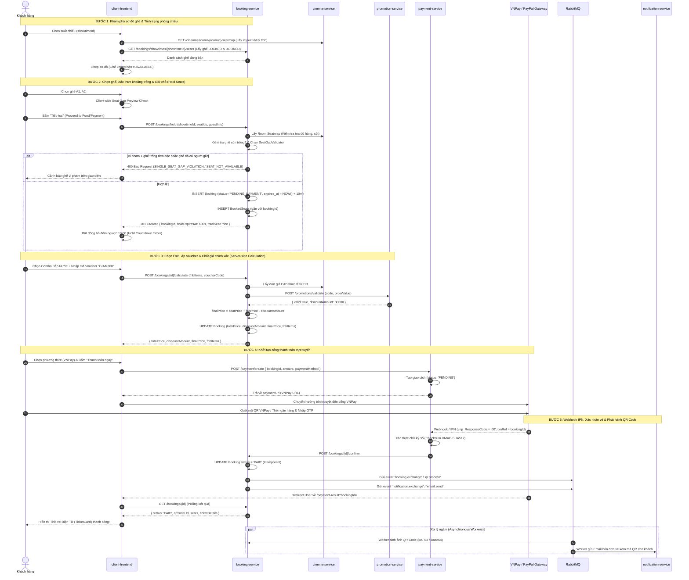
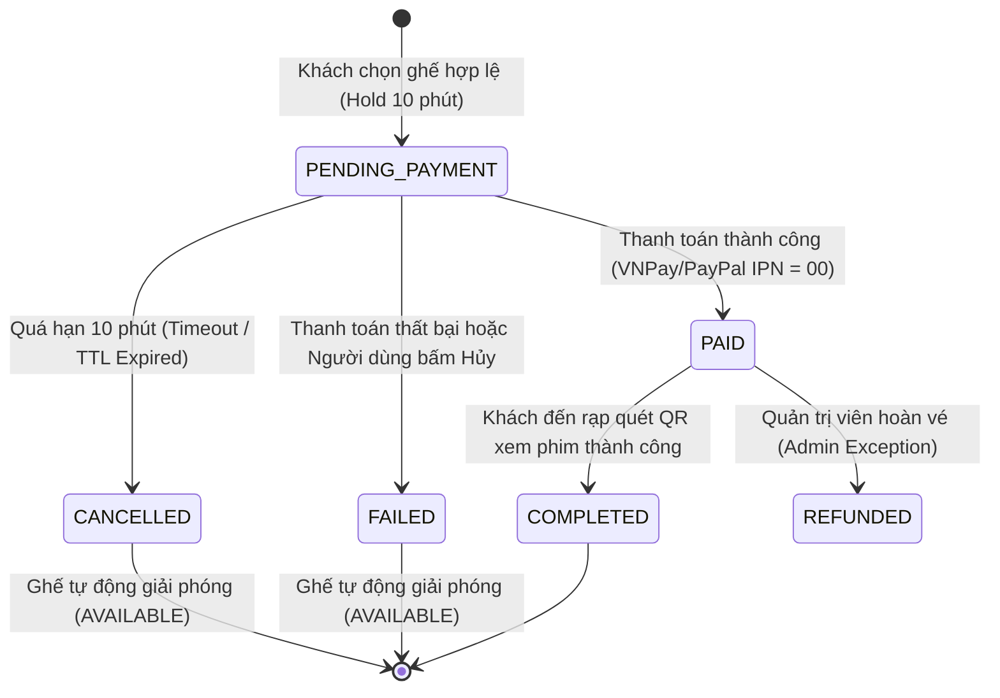

# Feature: End-to-End Cinema Ticket Booking Workflow Specification

| Metadata | Details |
| :--- | :--- |
| **Feature ID** | CM-000006 |
| **Category** | Core Business Workflow / End-to-End Integration / Transaction Lifecycle |
| **Target Services** | `booking-service`, `payment-service`, `core/cinema-service`, `core/showtime-service`, `core/promotion-service`, `notification-service`, `client-frontend` |
| **Status** | 🟣 In Design |
| **Priority** | P0 - Critical |
| **Author / Tech Lead** | Core Engineering Team |

---

## 1. Overview

### 1.1 Purpose
Tài liệu này đặc tả **toàn bộ quy trình nghiệp vụ và luồng kỹ thuật chuẩn xác (End-to-End Booking Workflow)** cho nền tảng đặt vé xem phim CineMeow. 

Mục tiêu là cung cấp một bản thiết kế chuẩn mực (Blue-print) giúp đội ngũ phát triển tái triển khai (re-implement) toàn bộ luồng đặt vé: từ khám phá sơ đồ ghế, giữ chỗ tạm thời (Seat Holding có đồng hồ đếm ngược 10 phút), tính giá bảo mật từ Server-side, thanh toán qua Payment Gateway, xử lý IPN Webhook idempotent, phát hành vé điện tử QR Code, đến cơ chế tự động hủy và giải phóng ghế khi hết hạn.

### 1.2 Current System Flaws & Technical Debt
1. **Thiếu cơ chế Giữ ghế tạm (Seat Holding):** Khách hàng chọn ghế, chọn combo bắp nước, điền thông tin cá nhân trong 3–5 phút nhưng ghế **chưa hề được giữ trên hệ thống**. Đến khi bấm "Thanh toán" mới tạo booking $\rightarrow$ Khách hàng khác vào chọn trùng ghế gây xung đột hoặc báo lỗi gây ức chế (Poor UX).
2. **Lỗ hổng bảo mật tính giá (Client-side Price Tampering):** Hiện tại Client tự tính `totalPrice`, `discountAmount`, `finalPrice` và gửi lên cho Backend lưu. Bất kỳ ai cũng có thể sửa request payload để mua vé giá 1.000 VNĐ.
3. **Thiếu cơ chế Tự động nhả ghế (Auto-Release / Rollback on Timeout):** Khi khách mở cổng VNPay/PayPal rồi tắt trình duyệt hoặc huỷ thanh toán, không có cơ chế hoàn trả ghế ngay lập tức, dẫn đến tình trạng "ghế ma" (bị treo).
4. **Phân mảnh trạng thái giữa 2 services:** `showtime-service` quản lý ghế tĩnh trong khi `booking-service` quản lý giao dịch $\rightarrow$ Được khắc phục triệt để bằng việc hợp nhất kho ghế động về `booking-service` (theo spec `CM-000005`).

---

## 2. Goals & Success Metrics

- **Mục tiêu nghiệp vụ:**
  - Trải nghiệm đặt vé mượt mà: Chọn ghế $\rightarrow$ Giữ ghế tức thì (10 phút) $\rightarrow$ Đặt combo bắp nước $\rightarrow$ Áp mã giảm giá $\rightarrow$ Thanh toán $\rightarrow$ Nhận vé xem phim kèm mã QR vào rạp qua Email và màn hình kết quả.
  - 100% tuân thủ quy tắc chống bỏ trống 1 ghế đơn độc (**Single-Seat Gap Rule**).
  - Không bao giờ xảy ra tình trạng bán trùng 1 ghế cho 2 người (Zero Overbooking Guarantee).
- **Mục tiêu bảo mật & kỹ thuật:**
  - 100% giá vé, giá bắp nước, số tiền giảm giá và số tiền cuối cùng phải do **Backend tính toán và xác thực** từ dữ liệu gốc của DB. Client chỉ gửi danh sách ID.
  - Idempotent Payment Processing: Callback/Webhook từ cổng thanh toán gọi lại nhiều lần chỉ ghi nhận thanh toán 1 lần duy nhất.
  - Độ trễ phản hồi API giữ ghế: $< 100\text{ ms}$.

---

## 3. Scope

| In Scope | Out of Scope |
| :--- | :--- |
| • Luồng lấy sơ đồ ghế & đối chiếu trạng thái động.<br>• Thuật toán Single-Seat Gap Validation ở phía Server.<br>• Luồng Giữ ghế tạm thời (Seat Holding) với thời hạn TTL 10 phút.<br>• Server-side Pricing Engine (Showtime Price + Seat Type Surcharge + F&B + Promotion).<br>• Tích hợp thanh toán VNPay / PayPal & Xử lý Webhook IPN.<br>• Phát hành vé QR Code & Bắn email xác nhận bất đồng bộ (RabbitMQ).<br>• Cơ chế Auto-Release ghế khi hết hạn 10 phút hoặc huỷ đơn. | • Tính năng đổi vé / hoàn tiền sau khi đã thanh toán thành công (Refund policy).<br>• Tính năng chọn rạp tự động theo vị trí GPS của người dùng.<br>• Quét mã QR tại cổng soát vé rạp (Ticket Scanner App cho nhân viên - Phase sau). |

---

## 4. End-to-End Workflow & Architecture Design

### 4.1 Master Sequence Diagram (Luồng Đặt Vé Toàn Diện)



---

### 4.2 State Machine của một Booking (Vòng đời trạng thái đơn vé)

Mọi giao dịch đặt vé đều tuân theo mô hình máy trạng thái hữu hạn (Finite State Machine) nghiêm ngặt sau:



| Trạng thái | Ý nghĩa nghiệp vụ | Trạng thái ghế đối với Suất chiếu |
| :--- | :--- | :--- |
| `PENDING_PAYMENT` | Đơn hàng vừa khởi tạo, đang giữ chỗ tối đa 10 phút để khách nhập bắp nước & thanh toán. | **`LOCKED`** (Khách khác không được chọn) |
| `PAID` | Khách đã thanh toán thành công, vé chính thức được phát hành. | **`BOOKED`** (Đã bán vĩnh viễn) |
| `FAILED` | Khách thanh toán lỗi (thẻ hết tiền, sai OTP) hoặc bấm huỷ tại cổng thanh toán. | **`AVAILABLE`** (Nhả ghế tức thì) |
| `CANCELLED` | Đơn hàng bị huỷ do quá 10 phút không hoàn tất thanh toán. | **`AVAILABLE`** (Nhả ghế tự động) |
| `COMPLETED` | Khách đã được quét QR tại rạp và vào phòng xem phim. | **`BOOKED`** (Lịch sử hoàn tất) |

---

## 5. Chi tiết 8 bước kỹ thuật chuẩn mực (Detailed Step-by-Step Implementation)

### Bước 1: Khám phá sơ đồ ghế (Seat Map & Status Discovery)
- **Mục đích:** Người dùng mở màn hình đặt vé $\rightarrow$ Hiển thị sơ đồ ghế chính xác của phòng chiếu kèm ghế nào đã bán, ghế nào đang có người giữ, ghế nào còn trống.
- **API luồng thực thi:**
  1. Frontend gọi `GET /api/v1/cinemas/rooms/{roomId}/seatmap` $\rightarrow$ Nhận toàn bộ ma trận ghế vật lý (hàng `A-K`, cột `1-16`, loại ghế `STANDARD`, `VIP`, `COUPLE`, `EMPTY`).
  2. Frontend gọi `GET /api/v1/bookings/showtimes/{showtimeId}/seats` $\rightarrow$ Nhận danh sách các ghế đang bị chiếm giữ (`BOOKED` và `LOCKED`).
  3. Frontend merge: Ghế nào không nằm trong danh sách bận $\rightarrow$ hiển thị trạng thái `AVAILABLE`.

### Bước 2: Kiểm tra Single-Seat Gap Rule & Giữ ghế tạm (Hold Seats)
- **Mục đích:** Ngăn chặn tuyệt đối việc để trống 1 ghế đơn độc và khóa ghế ngay lập tức trong 10 phút để khách yên tâm thanh toán.
- **Contract API:**
  ```http
  POST /api/v1/bookings/hold
  Content-Type: application/json

  {
    "showtimeId": "st-uuid-9876",
    "seatIds": [101, 102],
    "guestInfo": {
      "name": "Nguyễn Văn A",
      "email": "vana@gmail.com",
      "phone": "0912345678"
    }
  }
  ```
- **Backend xử lý:**
  1. Kiểm tra từng `seatId` trong `seatIds`: nếu đã có trong `BookedSeat` với Booking đang `CONFIRMED` hoặc (`PENDING_PAYMENT` và `created_at >= NOW() - 10m`) $\rightarrow$ Báo lỗi `409 Conflict: SEAT_ALREADY_RESERVED`.
  2. Lấy sơ đồ ghế phòng chiếu từ cache/`cinema-service`, merge trạng thái và gọi [`SeatGapValidator.validate(positions, selectedSeatIds)`](file:///e:/Workspace/LEARN/springboot_projects/CineMeow/core/showtime-service/src/main/java/com/cinemeow/showtime_service/validator/SeatGapValidator.java). Nếu vi phạm $\rightarrow$ Báo lỗi `400 Bad Request: SINGLE_SEAT_GAP_VIOLATED`.
  3. Tính tiền ghế gốc: `totalSeatPrice = SUM(showtime.basePrice * seatType.multiplier)`.
  4. Lưu `Booking` với `status = 'PENDING_PAYMENT'`, `created_at = NOW()`.
  5. Lưu danh sách `BookedSeat` gắn với `booking_id`.
  6. Trả về `bookingId`, `holdExpiresAt: 600` (giây). Phía Client bật đồng hồ đếm ngược `10:00`.

### Bước 3: Đặt Bắp nước & Tính toán giá Server-Side (Secure Pricing)
- **Mục đích:** Khách chọn bắp nước, áp voucher ưu đãi. Giá tiền **phải được tính toán tuyệt đối an toàn trên Server**.
- **Contract API:**
  ```http
  POST /api/v1/bookings/{bookingId}/calculate
  Content-Type: application/json

  {
    "fnbItems": [
      { "fnbItemId": "fnb-01", "quantity": 1 }
    ],
    "voucherCode": "CINEMEOW30K"
  }
  ```
- **Backend xử lý:**
  1. Đọc lại `Booking` theo `bookingId`. Kiểm tra xem đơn còn trong thời hạn 10 phút không.
  2. Gọi `cinema-service` lấy đơn giá gốc của từng món F&B $\rightarrow$ Tính `totalFnbPrice`.
  3. Tính tổng trước giảm: `totalPrice = totalSeatPrice + totalFnbPrice`.
  4. Nếu có `voucherCode`: Gọi `promotion-service` kiểm tra điều kiện (hạn dùng, đơn tối thiểu, số lượng còn lại) $\rightarrow$ Lấy `discountAmount`.
  5. Số tiền thanh toán cuối cùng: `finalPrice = MAX(0, totalPrice - discountAmount)`.
  6. Cập nhật các trường này vào DB và trả về kết quả cho Frontend hiển thị.

### Bước 4: Khởi tạo thanh toán (Payment Initiation)
- **Mục đích:** Sinh URL chuyển hướng sang Cổng VNPay hoặc PayPal.
- **Contract API:**
  ```http
  POST /api/v1/payment/create
  Content-Type: application/json

  {
    "bookingId": "bk-uuid-5555",
    "paymentMethod": "VNPAY"
  }
  ```
- **Backend (`payment-service`) xử lý:**
  1. Đọc `Booking` từ `booking-service` để lấy đúng số tiền `finalPrice` từ DB (không nhận số tiền từ Client!).
  2. Tạo bản ghi `Payment` với `status = 'PENDING'`, `booking_id = ...`.
  3. Ký mã checksum bảo mật (HMAC-SHA512 với VNPay secret key).
  4. Trả về `paymentUrl`. Frontend chuyển hướng khách sang VNPay.

### Bước 5: Xử lý IPN Webhook & Idempotency (Payment Callback)
- **Mục đích:** Cổng thanh toán gọi ngầm (Server-to-Server) để xác nhận kết quả thanh toán. Đảm bảo an toàn ngay cả khi khách hàng tắt trình duyệt trước khi redirect về.
- **Contract Webhook:** `GET /api/v1/payment/vnpay-callback` hoặc IPN URL.
- **Backend xử lý:**
  1. Xác thực chữ ký số (Checksum verification). Nếu chữ ký giả mạo $\rightarrow$ Từ chối ngay lập tức.
  2. Kiểm tra mã giao dịch `vnp_ResponseCode`:
     - Nếu `'00'` (Thành công):
       - Cập nhật `Payment.status = 'SUCCESS'`.
       - Gọi `bookingService.confirmBooking(bookingId)`.
       - Đổi `Booking.status = 'PAID'`. (Lưu ý: Nếu đơn hàng đã là `PAID` thì bỏ qua - Idempotent).
     - Nếu khác `'00'` (Khách hủy hoặc lỗi thẻ):
       - Cập nhật `Payment.status = 'FAILED'`.
       - Đổi `Booking.status = 'FAILED'`.
       - Xóa hoặc nhả ghế tức thì để người khác có thể chọn lại.

### Bước 6: Phát hành vé QR Code & Gửi Email (Asynchronous Fulfillment)
- **Mục đích:** Sau khi đơn thành `PAID`, phát hành mã QR để khách vào rạp và gửi email hóa đơn.
- **Backend xử lý bất đồng bộ qua RabbitMQ:**
  1. Event `booking.exchange` $\rightarrow$ Queue `qr.process`:
     - Payload mã hóa: `bookingCode` + `showtimeId` + `seatLabels` + chữ ký điện tử.
     - Sinh ảnh QR Code và lưu URL vào `Booking.qr_code_url`.
  2. Event `notification.exchange` $\rightarrow$ Queue `email.send`:
     - Đẩy thông tin phim, suất chiếu, rạp, phòng, danh sách ghế, tổng tiền và đính kèm ảnh QR Code gửi đến email khách hàng (`guestInfo.email`).

### Bước 7: Trả kết quả trên giao diện Client (Payment Result Polling)
- **Frontend xử lý tại [`PaymentResultPage.jsx`](file:///e:/Workspace/LEARN/springboot_projects/CineMeow/frontend/client-frontend/src/pages/PaymentResultPage.jsx):**
  1. Đọc `bookingId` từ URL parameters.
  2. Thực hiện Polling `GET /bookings/{bookingId}` mỗi 2 giây (tối đa 5 lần) để chờ trạng thái chuyển từ `PENDING` sang `PAID`.
  3. Khi nhận trạng thái `PAID` $\rightarrow$ Dừng polling, hiển thị thẻ vé điện tử sang trọng [`TicketCard`](file:///e:/Workspace/LEARN/springboot_projects/CineMeow/frontend/client-frontend/src/components/Booking/TicketCard.jsx) kèm QR Code và hướng dẫn vào phòng chiếu.

### Bước 8: Tự động giải phóng ghế khi hết hạn (Auto-Release / Rollback on Timeout)
- **Mục đích:** Xử lý trường hợp khách hàng giữ ghế rồi tắt app / không thanh toán trong 10 phút.
- **Cơ chế 2 lớp an toàn:**
  - **Lớp 1 (Query Level - Real-time Filtering):** Trong câu query kiểm tra ghế bận của Bước 1 & Bước 2, điều kiện `b.created_at >= NOW() - INTERVAL '10 minutes'` sẽ **ngay lập tức loại trừ** các booking quá 10 phút. Người khác vào xem sẽ thấy ghế đã tự động thành `AVAILABLE` mà không cần đợi bất kỳ scheduler nào chạy!
  - **Lớp 2 (Background Cleaner Job):** Mỗi 5 phút, một Spring `@Scheduled` task quét các đơn `PENDING_PAYMENT` có `created_at < NOW() - 15 minutes` để cập nhật trạng thái đơn thành `CANCELLED`.

---

## 6. Implementation Roadmap

### Phase 1: Backend Core Booking & Secure Pricing
- [ ] Bổ sung trường `expires_at` và `guest_info` vào entity `Booking`.
- [ ] Viết API `POST /bookings/hold` thực hiện kiểm tra `SeatGapValidator` và giữ ghế 10 phút.
- [ ] Viết API `POST /bookings/{id}/calculate` tính toán giá tiền an toàn ở Server (Showtime + F&B + Voucher).
- [ ] Viết Unit & Integration Test cho luồng tính giá và giữ ghế.

### Phase 2: Payment Integration & Idempotent Callback
- [ ] Cập nhật `payment-service`: chỉ lấy số tiền từ DB qua `BookingClient`, loại bỏ việc nhận `amount` tự do từ client.
- [ ] Hoàn thiện logic xử lý IPN Webhook: xác thực chữ ký số HMAC-SHA512, cập nhật trạng thái `PAID` idempotent.
- [ ] Xử lý nhả ghế ngay lập tức khi thanh toán trả về mã lỗi (`vnp_ResponseCode != '00'`).

### Phase 3: Frontend Refactoring & Polling
- [ ] Refactor [`BookingPage.jsx`](file:///e:/Workspace/LEARN/springboot_projects/CineMeow/frontend/client-frontend/src/pages/BookingPage.jsx):
  - Chuyển việc tạo đơn giữ chỗ lên ngay sau khi chọn xong ghế (`POST /bookings/hold`).
  - Thêm component đồng hồ đếm ngược 10:00 (Hold Countdown Banner) ở đầu trang.
  - Loại bỏ hoàn toàn logic tự tính `finalPrice` gửi lên backend; gọi API `calculate` để lấy giá chính xác.
- [ ] Tinh chỉnh [`PaymentResultPage.jsx`](file:///e:/Workspace/LEARN/springboot_projects/CineMeow/frontend/client-frontend/src/pages/PaymentResultPage.jsx): tối ưu hóa polling UX và hiển thị vé QR Code.

### Phase 4: Auto-Release & Stress Testing
- [ ] Viết scheduled task dọn dẹp các booking `CANCELLED` quá hạn.
- [ ] Chạy stress-test mô phỏng 500 người cùng tranh 10 ghế trong phòng chiếu để đảm bảo không bao giờ bị overbooking.

---

## 7. Definition of Done (DoD)

- [ ] Ghế được khóa giữ chỗ tối đa 10 phút ngay khi bấm tiếp tục sau bước chọn ghế.
- [ ] Thuật toán `SeatGapValidator` chặn đứng 100% các thao tác tạo ghế trống đơn độc ở bước giữ chỗ.
- [ ] 100% số tiền đơn hàng được tính toán và xác thực tại Backend.
- [ ] Thanh toán qua VNPay/PayPal cập nhật trạng thái đơn thành `PAID` thông qua IPN Webhook an toàn.
- [ ] Khách hàng nhận được vé QR Code hợp lệ hiển thị trên màn hình và qua Email.
- [ ] Ghế quá hạn 10 phút không thanh toán tự động nhả về trạng thái `AVAILABLE`.
- [ ] Đạt độ bao phủ kiểm thử tự động $\ge 85\%$.

